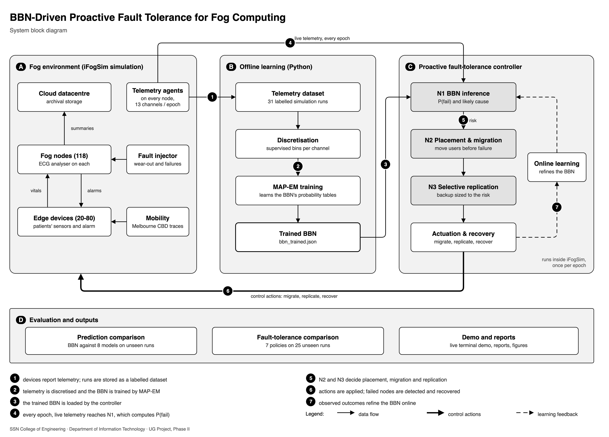

# The project, explained

A study guide for the final-year review: what was changed and why, how to run everything,
how the system works, and where the important code is. Every code reference is a link of the
form `file:line`; in VSCode, open this file in the Markdown preview (or Ctrl/Cmd-click the
link) to jump straight to the line.

| Part | What it answers |
|---|---|
| [0. The project in two minutes](#0-the-project-in-two-minutes) | the whole story, short |
| [1. Changes made, and why](#1-changes-made-and-why) | what was wrong before, what we changed, why |
| [2. How to run the project](#2-how-to-run-the-project) | setup, commands, what you will see, troubleshooting |
| [3. How the system works](#3-how-the-system-works) | every component, explained from the ground up |
| [4. Important code, with exact locations](#4-important-code-with-exact-locations) | the snippets that matter and what each does |
| [5. Numbers to know](#5-numbers-to-know) | the results you should be able to quote |
| [6. Questions you may be asked](#6-questions-you-may-be-asked) | likely review questions, with answers |
| [7. Glossary](#7-glossary) | every technical term in one line |

---

## 0. The project in two minutes

**The problem.** Fog computing places small servers (*fog nodes*, here street-side gateways)
close to users so that responses are fast. These nodes are cheap, crowded and exposed, and they
fail. When one fails, every service on it stops and its working state is lost: users wait for
the failure to be noticed and for the service to restart somewhere else.

**The idea.** Hardware rarely dies out of the blue. It degrades first: it slows down, its queue
grows, it heats up, it draws more power. If we can estimate, every few seconds, *the probability
that each node will fail soon*, we can move services away **before** the failure and give the
most important patients extra protection.

**What we built.**

1. **A realistic simulation** in iFogSim (the standard research simulator for fog computing): a
   heart-monitoring application for 20-80 patients walking around Melbourne's city centre, 118
   fog gateways, 1 cloud datacentre. Nodes wear out under stress and fail according to a fault
   model we wrote.
2. **Telemetry.** Every node reports 13 measurements (CPU, queue, latency, temperature, energy and
   their trends) every *epoch* (100 simulation time units).
3. **A Bayesian Belief Network (BBN)** learns from that telemetry the probability
   `P(node fails within the next two epochs)`, and names the condition behind the risk
   (computational, network, energy or thermal stress).
4. **A controller inside the simulator** uses that probability every epoch to score every node
   (novelty **N1**), move patients off risky nodes and place users on safe ones (**N2**), and give
   each patient the right amount of backup (**N3**).

**What we found.**

- The BBN predicts failures as well as the best machine-learning model (random forest) and gives
  the **best-calibrated probabilities** of all models, which matters because the controller
  multiplies those probabilities by costs.
- It keeps the best probabilities when telemetry goes missing, it works before any failure has
  ever been seen, and it explains every alarm.
- Inside iFogSim, the BBN-driven controller cuts downtime caused by failures by **97%** compared
  with no fault tolerance, **85%** compared with reactive checkpointing and **55%** compared with
  the FTAPA threshold method, while keeping a backup ready for only **0.2%** of patients.

> **One sentence for the review:** "We trained a Bayesian network on iFogSim telemetry to
> predict which fog nodes will fail in the next two epochs, and built a controller inside
> iFogSim that uses those probabilities to migrate and replicate services before the failure; the
> BBN matches the best machine-learning model in accuracy, has the best-calibrated
> probabilities, survives missing telemetry, explains its alarms, and cuts failure downtime by
> 55-97% against three published baselines."

---

## 1. Changes made, and why

### 1.1 Where the project started

At the start of Phase II the repository already had an iFogSim telemetry generator, a BBN trained
by expectation-maximisation, and a model comparison. A careful review found these problems:

| Problem | Why it mattered |
|---|---|
| **A data leak.** The fault injector used one random seed for all twelve scenarios and keyed its random draws on (node, epoch) only. The same node therefore failed at the same moment in every scenario: 92.1% of the nodes failing in both a test and a training run failed at the same epoch. | A model could memorise "node 57 fails at epoch 31" and score well on the test set without predicting anything. The earlier comparison was invalid. |
| **Failures without warning signs.** Failures came from a memoryless random process. | Even a perfect predictor could barely foresee them (oracle ROC-AUC about 0.69), so *proactive* fault tolerance had nothing to work with. |
| **Failures had no effect.** A failure was only a label in the CSV; the node kept serving. | You cannot show that fault tolerance helps if failures do not hurt. |
| **No controller.** Migration and replication were described in the paper but not implemented (the old README's limitation 9). | The paper's three novelties (N1-N3) were missing. |
| **An unrealistic test set.** 200 hand-picked cases with 40% failures, while the real failure rate is about 0.3%; 40 of the 120 negatives were trivial cloud rows. | Scores did not reflect deployment, and alarm thresholds tuned on balanced data do not transfer. |
| **Weak discretisation.** Every channel cut into three equal-sized bins (tertiles). | Failures live in the extreme tail of a channel; a tertile puts pre-failure readings in the same "high" bin as a third of all healthy readings (cross-validated PR-AUC only 0.041). |
| **Smaller defects.** A lead-time function merged different nodes with the same name across scenarios; the MAP-EM prior drifted every iteration; the "proposed model" was a BBN + risk-head fusion rather than the BBN. | Wrong numbers, and not the method the paper proposes. |

Before changing anything, a full snapshot was saved: `_backup/pre_phase2_2026-10-17.tar.gz`.

### 1.2 The changes

#### Change 1. A new fault model: nodes wear out before they fail

- **What.** Every fog node and user device now carries a hidden *health* between 0 and 1. Older
  hardware starts lower. Every epoch it loses some health; the loss grows exponentially with the
  node's *stress* (utilisation, backlog, heat, energy depletion, poor links, handovers), is noisy,
  and is occasionally hit by a *shock*. When health reaches 0 the node fails. About one failure in
  five is *sudden* (no warning at all), and user devices also die when their battery runs flat.
- **Fail-slow symptoms.** As health falls the node really degrades *inside iFogSim*: each tuple
  needs more CPU work, its network interface slows, it draws extra power and runs hotter. The
  telemetry then measures those effects from iFogSim's own state.
- **Why.** Real hardware "fails slow" (this is documented field behaviour), and proactive fault
  tolerance only makes sense if failures announce themselves. The sudden failures keep it honest:
  no model can predict them, exactly as in reality.
- **Where.** [FaultInjector.java](ifogsim/src/org/fog/ft/FaultInjector.java): stress formula
  [:258](ifogsim/src/org/fog/ft/FaultInjector.java#L258), one epoch of wear and the failure
  decision [:276](ifogsim/src/org/fog/ft/FaultInjector.java#L276), symptoms
  [:212-233](ifogsim/src/org/fog/ft/FaultInjector.java#L212).

#### Change 2. The leak fix: every random draw is keyed on the scenario too

- **What.** All randomness now comes from [FtRandom.java](ifogsim/src/org/fog/ft/FtRandom.java),
  which turns the *coordinates* of a draw (seed, scenario, node, epoch, purpose) into a number with
  a hash function ([:52](ifogsim/src/org/fog/ft/FtRandom.java#L52)).
- **Why.** Two consequences, both essential:
  1. Different scenarios or seeds get **independent** failure luck, so test failures share nothing
     with training failures. The leak audit now shows 2.0% same-epoch coincidences (chance level)
     instead of 92.1% ([build_dataset.py:84](model/build_dataset.py#L84)).
  2. Two policies run on the same scenario and seed face **identical** luck (the same initial
     wear, noise, shocks and sudden failures). This is called *common random numbers*: any
     difference between policies is caused by their decisions alone.

#### Change 3. Failures now really stop service

- **What.** In [InstrumentedFogDevice.java](ifogsim/src/org/fog/ft/InstrumentedFogDevice.java) a
  failed node clears its queues, drops every tuple it receives, sends nothing and stops reporting
  ([:173](ifogsim/src/org/fog/ft/InstrumentedFogDevice.java#L173),
  [:211](ifogsim/src/org/fog/ft/InstrumentedFogDevice.java#L211)). An `ecg_analyser` now runs on
  every fog node and in the cloud; each patient's analysis *session*
  ([ServiceSession.java](ifogsim/src/org/fog/ft/ServiceSession.java)) is charged downtime whenever
  its node is dead or its state is being restored or moved. Results are routed back to the right
  patient, and forwarded once if the patient handed over to another gateway meanwhile
  ([:274](ifogsim/src/org/fog/ft/InstrumentedFogDevice.java#L274)).
- **Why.** Fault tolerance can only be evaluated if failures have consequences that it can
  prevent or shorten.

#### Change 4. Richer, more realistic telemetry

- **What.** Besides the eight original measurements, each node's agent now reports five *trends*
  (change of CPU, queue, latency and temperature against its last three readings, and the energy
  drain rate) ([:420](ifogsim/src/org/fog/ft/InstrumentedFogDevice.java#L420)). Temperature comes
  from a simple thermal model driven by utilisation and degradation
  ([:588](ifogsim/src/org/fog/ft/InstrumentedFogDevice.java#L588)) with sensor noise. Channels can
  be withheld at random (MCAR) or more often on degrading nodes (MNAR) for the robustness
  experiments ([:438](ifogsim/src/org/fog/ft/InstrumentedFogDevice.java#L438)).
- **Why.** A degrading node shows a *drift* before it shows an extreme value, so trends are early
  warning signs. Missing telemetry is the situation where a BBN should shine, so it had to be
  testable.

#### Change 5. A valid dataset design

- **What.** 31 complete simulation runs: training = 7 operating regimes x 3 seeds (21 runs); test =
  5 *different* regimes x 2 *different* seeds (10 runs). Whole runs are held out, and every row is
  kept at its natural failure rate (0.26% in the test pool). Defined in
  [design.py:28](model/design.py#L28).
- **Why.** Consecutive snapshots of one node are nearly identical, so a random row split would test
  on near-copies of training data. Holding out regimes *and* seeds tests the model on conditions it
  has never seen, and the natural failure rate makes the numbers realistic.

#### Change 6. The BBN, improved step by step

Each step was accepted only if it improved the cross-validated score **on training scenarios
only** (the test runs were used once, at the very end). Script:
[select_bbn.py](model/select_bbn.py); results: `model/results/bbn_selection.csv`.

| Step | Change | Cross-validated PR-AUC |
|---|---|---:|
| 0 | the paper's graph with tertile bins | 0.041 |
| 1 | **supervised cut points**: bins placed where the failure rate changes (exact dynamic programming) | 0.434 |
| 2 | **trend channels** added as evidence | 0.562 |
| 3 | **learned ranked-node tables** with 8 bins per channel, device class as a parent | 0.653 |
| 4 | bins chosen **separately for each device class** | 0.753 |
| 5 | weaker prior on the failure table (selected configuration) | **0.759** |

Why these were needed: the original network threw away most of the information in the telemetry
(three coarse bins in the wrong places). Finer bins were impossible with ordinary tables (a node
with five parents of eight states needs 32,768 rows), so the tables were re-expressed as *ranked
nodes* whose few parameters can be learned (explained in [3.3](#33-block-b-the-bayesian-belief-network)).
On the held-out runs the final BBN reaches ROC-AUC 0.866 and PR-AUC 0.639 (the paper's original
network with elicited tables: 0.750 and 0.015).

#### Change 7. The BBN runs inside the simulator and keeps learning

- **What.** The trained network is saved as one JSON file, `data/bbn_trained.json`
  ([bbn_io.py:26](model/bbn_io.py#L26)). A Java engine
  ([BbnEngine.java](ifogsim/src/org/fog/ft/BbnEngine.java)) loads the same file inside iFogSim and
  computes exactly the same probabilities as Python (checked to 1e-15). During a run it also
  *learns online*: once a report's outcome is known, it updates the failure table
  ([:486](ifogsim/src/org/fog/ft/BbnEngine.java#L486), [:546](ifogsim/src/org/fog/ft/BbnEngine.java#L546)).
- **Why.** The decisions must be made by the trained BBN *in the loop*, not offline, and the model
  should adapt to the deployment it runs in.

#### Change 8. The fault-tolerance controller and six comparison policies

- **What.** [FaultToleranceController.java](ifogsim/src/org/fog/ft/FaultToleranceController.java)
  implements the paper's control loop as a CloudSim entity: N1 inference, N2 risk-aware placement
  (Eq. 2) and expected-loss migration (Eq. 3), N3 selective replication (Eq. 4), failure detection
  and recovery, and all the metrics. Seven policies run through this one class
  ([FtPolicy.java](ifogsim/src/org/fog/ft/FtPolicy.java)): no fault tolerance, cloud-only placement,
  reactive checkpointing (Rajab and Younis 2021), threshold migration (FTAPA, Gupta and Singh
  2025), the same controller driven by machine learning, the proposed BBN framework, and an
  oracle with a perfect predictor.
- **Why.** This is the project's main contribution, previously missing. Running every policy
  through the same code means the comparison isolates the decision logic.

#### Change 9. A fair comparison with eight other models

- **What.** [comparison/run_comparison.py](model/comparison/run_comparison.py) compares the BBN
  with the elicited BBN, Naive Bayes, logistic regression, random forest, gradient boosting, a
  neural network (MLP), the FTAPA health index and a CPU threshold. Every choice a model makes
  (class weighting, alarm threshold) is made on training folds; the test pool is scored once,
  with 95% confidence intervals; calibration, missing-telemetry robustness, data efficiency and
  speed are measured; an *accuracy ceiling* shows how much accuracy is achievable at all
  ([report_comparison.py:183](model/comparison/report_comparison.py#L183)).
- **Why.** "Why a BBN?" must be answered with a fair experiment, including the criteria where the
  BBN is not the winner.

#### Change 10. The closed-loop experiment

- **What.** [run_ft_experiments.py](model/run_ft_experiments.py) runs 450 simulations: 7 policies
  on 25 held-out runs (5 unseen regimes x 5 unseen seeds), the telemetry-driven policies again
  with 30% of the channels missing, the BBN policy with migration costs scaled 0.25-4x, and the BBN
  policy with each component removed (ablation). Paired Wilcoxon tests compare policies run by run.
  Downtime is split into the part fault tolerance controls (failures + migration pauses) and the
  part caused by mobility (handovers).
- **Why.** To show, with statistics, that the framework reduces downtime and which of its parts
  matter.

#### Change 11. One-command scripts and the terminal demo

- **What.** `run_all.sh` (the whole pipeline), `run_demo.sh` (the demonstration),
  `model/setup_venv.sh` (the Python environment) and [model/demo.py](model/demo.py), a nine-stage
  terminal demonstration that trains the BBN live and shows it running fault tolerance inside
  iFogSim, event by event.
- **Why.** The final output has to be demonstrated in the terminal, and anyone must be able to
  reproduce every number.

#### Change 12. Tests and independent cross-checks

- **What.** 50 automated tests ([test_inference.py](model/test_inference.py),
  [test_pipeline.py](model/test_pipeline.py), [test_java_parity.py](model/test_java_parity.py)) and a
  cross-check against pgmpy, an independent BBN library ([crosscheck_pgmpy.py](model/crosscheck_pgmpy.py)).
- **Why.** So that you can say with evidence that the inference is exact, training works, Java and
  Python agree, and the evaluation has no leak.

#### Change 13. Documentation and the block diagram

`README.md`, `DATA_GUIDE.md`, `model/MODEL_IMPROVEMENTS.md`, `model/comparison/README.md`, this
guide, the document `details/Project_Explained.docx` (Parts 1-4 of this guide), the system block
diagram `details/Project_Block_Diagram.png`, the BBN structure figure `details/BBN_Structure.png`
and a detailed architecture drawing `details/Project_Architecture_Detailed.png` (all drawn in
draw.io; the editable sources are the `.drawio` files next to them).

#### Change 14. Corrections made during final verification

| Found | Fixed |
|---|---|
| The "clairvoyant oracle" scored worse than the BBN, because it used a different code path (no risk-aware placement, no replication). | It now runs the same controller as BBN and ML with the best possible predictor (it knows the hidden health and the wear law, but not future random draws), so it is a true upper bound. |
| The verification report's cause table showed one row, because `pd.crosstab` aligned two Series by their index. | Plain arrays are used ([verify.py](model/verify.py)). |
| The explanation compared each condition with a prior pooled over device classes, which could blame *thermal stress* on a device without a thermal sensor. | The prior is now the one for the node's own class, in Java ([BbnEngine.java:455](ifogsim/src/org/fog/ft/BbnEngine.java#L455)) and Python ([inference.py:285](model/inference.py#L285)). |
| `score_one.py` took minutes; the reference inference engine hung when the device class was unknown (bad elimination order). | `score_one.py` uses the fast engine; variable elimination uses a greedy min-weight order ([inference.py:217](model/inference.py#L217)). |
| The pgmpy cross-check assumed three states per channel. | It reads each network's own states. |
| Closed-loop downtime mixed failures with mobility handovers; 10 runs per policy gave little statistical power. | Downtime is reported in both forms; 25 paired runs per policy. |

---

## 2. How to run the project

### 2.1 What you need

| Tool | Version | Check it | Install it (macOS / Ubuntu) |
|---|---|---|---|
| Java JDK (with `javac`) | 17 or newer (developed with 21) | `java -version` and `javac -version` | `brew install openjdk@21` / `sudo apt install openjdk-21-jdk` |
| Python | 3.10 or newer (developed with 3.12) | `python3 --version` | `brew install python@3.12` / `sudo apt install python3 python3-venv` |
| Disk / memory | about 2 GB free, 8 GB RAM | | |
| Internet | only the first time (to download Python packages) | | |

The Python packages (numpy, pandas, scipy, scikit-learn, matplotlib, rich, pytest and the
optional pgmpy) are listed in [model/requirements.txt](model/requirements.txt) and installed
automatically into a private environment, `model/.venv`.

### 2.2 First-time setup

```bash
cd "/path/to/FogComputing"          # the project folder (contains README.md)
bash model/setup_venv.sh            # creates model/.venv and installs the packages
cd ifogsim && bash build.sh && cd ..    # compiles the Java code (also done by the scripts)
```

`setup_venv.sh` picks Python 3.12 if available, creates the environment and installs the
requirements; if the optional pgmpy fails to install, it installs everything else.
You can skip this step: `run_demo.sh` and `run_all.sh` do it on first use.

### 2.3 Run the demonstration

```bash
bash run_demo.sh              # under a minute when results already exist
bash run_demo.sh --no-pause   # plays the live run without pacing
```

If no results exist yet, it first runs the whole pipeline once (about 45 minutes). What you see:

| Stage | What happens |
|---|---|
| 1 Build | compiles the Java package (`compiled 174 classes`) |
| 2 The simulated system | the topology tree; which scenarios and seeds train and which are held out |
| 3 Telemetry | the 31 runs: snapshots, failed nodes by cause (wear-out, sudden, battery) |
| 4 Dataset and leak audit | pool sizes at natural prevalence; 2.0% leak audit vs 92.1% before |
| 5 Training (live) | the BBN graph, then **EM training live** with a progress bar; checks that the retrained model equals the saved one |
| 6 Prediction comparison | nine models side by side; PR-AUC as telemetry goes missing |
| 7 **LIVE fault tolerance** | the trained BBN controlling iFogSim on an unseen scenario: every migration with its P(fail), threshold P* and cause; every failure and recovery |
| 8 All policies | the seven policies on the same run, then the averages over 25 runs with p-values |
| 9 Verdict | the evidence for choosing a BBN, including where it is not ahead |

Make the terminal wide (150 columns or more) so that the tables do not wrap.

### 2.4 Regenerate everything from scratch

```bash
bash run_all.sh                    # about 45 minutes
bash run_all.sh --skip-selection   # reuse the chosen BBN configuration (~13 min faster)
```

`run_all.sh` runs these steps; you can also run any of them yourself from `model/` with
`.venv/bin/python`:

| Step | Command (from `model/`) | Takes | Produces |
|---|---|---|---|
| 1 compile Java | `bash ../ifogsim/build.sh` | 10 s | `ifogsim/build/classes` |
| 2 telemetry | `python generate_telemetry.py` | ~5 min | `data/raw/scenario_SS_seed_K.csv` (31 files) |
| 3 dataset | `python build_dataset.py` | 20 s | training and test pools, `dataset_manifest.json` |
| 4 model selection | `python select_bbn.py` | ~13 min | `data/models/bbn_config.json`, `results/bbn_selection.csv` |
| 5 training | `python train_bbn.py` | 10 s | `data/bbn_trained.json` |
| 6 verification | `python predict.py && python verify.py` | 1 min | `results/verification_report.md` |
| 7 comparison | `python comparison/run_comparison.py` | ~9 min | `comparison/results/model_comparison.md`, `data/models/ml_best.json`, `ftapa.json` |
| 8 fault tolerance | `python run_ft_experiments.py` | ~15 min | `results/ft/policy_comparison.md` |
| 9 tests | `python -m pytest -q test_inference.py test_pipeline.py test_java_parity.py` and `python crosscheck_pgmpy.py` | 40 s | pass / fail |

Everything is deterministic: running it again gives byte-identical telemetry and an identical
trained model (this was verified).

### 2.5 Smaller things to try (good for questions during the review)

Score one node by hand (from `model/`):

```bash
# a worn fog node just before a wear-out failure  ->  P(fail) = 0.78, energy stress
.venv/bin/python score_one.py --device-class fog --cpu 1.0 --queue 380 --latency 161 \
    --temperature 81 --temp-trend 5 --energy-drain 0.0032 --handovers 16 --show-work

# the same node with most channels missing  ->  still 0.12 (a healthy node is 0.0007)
.venv/bin/python score_one.py --device-class fog --cpu 1.0 --temperature 81 \
    --energy-drain 0.0032

# the paper's network with expert tables only (no failure data)
.venv/bin/python score_one.py --elicited --device-class fog --cpu 1.0 --queue 380 \
    --temperature 81
```

Run one simulation with a live event log (from `ifogsim/`):

```bash
CP="build/classes:jars/*:jars/commons-math3-3.5/*"
java -cp "$CP" org.fog.ft.FtExperiment --policy bbn --scenario 7 --seed 201 --log pretty \
     --bbn ../data/bbn_trained.json --out /tmp/run.json
```

Change `--policy` to `no-ft`, `cloud-only`, `reactive`, `threshold`, `ml` (add
`--ml ../data/models/ml_best.json`) or `oracle`; add `--dropout mnar --rate 0.3` to remove 30% of
the telemetry; `--no-migration`, `--no-replication`, `--no-risk-placement`, `--no-online` switch
parts off.

One closed-loop run per policy, quickly: `.venv/bin/python run_ft_experiments.py --quick`.

### 2.6 Where the results are

| File | Contents |
|---|---|
| `model/results/verification_report.md` | the BBN alone on the test runs: accuracy, alarms, calibration, early warning, causes, missing channels |
| `model/comparison/results/model_comparison.md` | the BBN against eight alternatives, accuracy ceiling, robustness, scorecard |
| `model/results/ft/policy_comparison.md` | the seven policies in iFogSim, paired tests, degraded telemetry, sensitivity, ablation |
| `model/results/*.png`, `model/comparison/results/*.png`, `model/results/ft/*.png` | the figures |
| `details/Project_Block_Diagram.png` | the system block diagram |

### 2.7 Troubleshooting

| Symptom | Fix |
|---|---|
| `Not compiled yet. Run ./build.sh first.` | `cd ifogsim && bash build.sh` (needs `javac`) |
| `javac: command not found` | install a JDK, not only a JRE (see 2.1) |
| `externally-managed-environment` from pip | always use the project environment: `bash model/setup_venv.sh` |
| `missing data/models/ml_best.json` | run `comparison/run_comparison.py` before `run_ft_experiments.py` |
| `crosscheck_pgmpy.py` says skipped | pgmpy is optional: `model/.venv/bin/pip install pgmpy` |
| tables wrap in the demo | widen the terminal |
| a test killed with exit 137 | out of memory: do not run the tests while the 8-JVM experiments run |

---

## 3. How the system works

### 3.1 The big picture



The block diagram (`details/Project_Block_Diagram.png`) has four stages: **A** the simulated fog
environment, **B** offline learning, **C** the proactive fault-tolerance controller and **D**
evaluation. Follow the numbered steps:

1. Devices report telemetry; complete runs are stored as a labelled dataset.
2. The telemetry is discretised and the BBN is trained by MAP-EM.
3. The trained BBN is loaded by the controller.
4. Every epoch, live telemetry reaches N1, which computes P(fail) for every fog node.
5. N2 and N3 decide placement, migration and replication.
6. The actions are applied to the environment; failed nodes are detected and recovered.
7. Observed outcomes refine the BBN online.

(A more detailed architecture drawing is in `details/Project_Architecture_Detailed.png`.)

How the pieces talk to each other:

| From -> to | Through |
|---|---|
| Java -> Python | telemetry CSVs in `data/raw/`; one JSON summary per simulation in `model/results/ft/runs/`; `@FT {...}` event lines on standard output (the live demo reads these) |
| Python -> Java | `data/bbn_trained.json` (the BBN), `data/models/ml_best.json` (the best classical model), `data/models/ftapa.json` (the FTAPA rule) |
| Python starts Java | [javarun.py](model/javarun.py) launches `java ... org.fog.ft.<Main>` from `ifogsim/`, up to 8 JVMs in parallel ([:40](model/javarun.py#L40)) |

Each simulation runs in its own JVM because CloudSim keeps its clock and entities in static
(global) variables.

### 3.2 Block A: the simulation

#### iFogSim in one paragraph

iFogSim is built on CloudSim, a **discrete-event simulator**: nothing runs in real time; instead
there is a queue of future events ("tuple arrives at node 5 at t = 1203.4", "resource
management at t = 1300"), and the simulator jumps from one event to the next. A **tuple** is one
message or task (for example a batch of heart readings). A **module** is a piece of the
application (for example the ECG analyser). Devices are arranged in a tree: cloud at the top, fog
nodes in the middle, user devices at the bottom. Time is measured in simulation *time units*,
read as milliseconds for network delays.

Our code lives in one new package, `ifogsim/src/org/fog/ft/`; nothing upstream was modified.

#### The topology and the application

- **Topology** ([MelbCBDFaultToleranceSim.java:223](ifogsim/src/org/fog/ft/MelbCBDFaultToleranceSim.java#L223)):
  one cloud datacentre, 118 fog gateways at their real positions from the Melbourne CBD dataset
  shipped with iFogSim, and 20-80 user devices that move along the Melbourne mobility traces.
  Every device is an `InstrumentedFogDevice`, our subclass of iFogSim's `FogDevice`.
- **Application** ([:329](ifogsim/src/org/fog/ft/MelbCBDFaultToleranceSim.java#L329)): cardiac
  monitoring. A sensor on the patient sends `VITALS` to the `client` module on the patient's device,
  which filters them and sends `FILTERED_VITALS` to the `ecg_analyser` on the serving fog node; the
  analyser returns an `ARRHYTHMIA_VERDICT`, and the client triggers the `ALARM` actuator. This loop
  must finish within 150 ms for critical patients. Summaries go to the cloud's `archival_store`.
- **Patients** ([Criticality.java:14](ifogsim/src/org/fog/ft/Criticality.java#L14)): 25% critical
  (ICU), 45% standard, 30% best-effort. The class sets the weight of a failure (kappa = 1.0, 0.5,
  0.15), the analyser state to move (300, 150, 50 KB) and the placement weights.
- **Twelve operating regimes** ([ScenarioSweep.java:28](ifogsim/src/org/fog/ft/ScenarioSweep.java#L28))
  vary the number of users, sensors, fog and edge capacity, backhaul and power. Regimes 0, 2, 3,
  4, 5, 6, 11 train the model; 1 (idle fleet), 7 (dense edge, 80 users), 8 (slow backhaul), 9 (fog
  heavy) and 10 (edge heavy) are held out.

#### What happens in one epoch

Every 100 time units iFogSim calls `manageResources` on every device
([InstrumentedFogDevice.java:370](ifogsim/src/org/fog/ft/InstrumentedFogDevice.java#L370)). Our
version does four things in order:

1. **Measure the true state** (`measure`, [:401](ifogsim/src/org/fog/ft/InstrumentedFogDevice.java#L401)):
   CPU utilisation, RAM, queue depth, uplink latency, jitter, handovers, residual energy,
   temperature, all read from iFogSim's own counters.
2. **Wear the node** (`FaultInjector.step`): compute the stress from the true state, subtract the
   wear from the hidden health, and decide whether the node fails during the coming epoch. If it
   does, a `NODE_FAIL` event is scheduled at a random moment inside that epoch.
3. **Report** (`report`, [:420](ifogsim/src/org/fog/ft/InstrumentedFogDevice.java#L420)): add sensor
   noise, apply telemetry dropout if the experiment asks for it, compute the five trends.
4. **Record** the report for the CSV (`TelemetryCollector`). The label `ground_truth_fail` (does the
   node fail within the next 200 time units?) is filled in at the end of the run, when all failure
   times are known ([FaultInjector.java:410](ifogsim/src/org/fog/ft/FaultInjector.java#L410)).

Meanwhile the [MobilityDriver](ifogsim/src/org/fog/ft/MobilityDriver.java) moves every user one step
along its trace every 100 time units and asks the controller which fog node should serve it.

#### The fault model in numbers

Per node and per epoch:

```text
stress  S = 1.6 cpu + 0.8 queue + 1.0 heat + 1.4 energy depletion
          + 0.4 latency + 0.3 jitter + 0.2 handovers            (each scaled to 0..1)
wear      = base(class) * exp(sensitivity(class) * S) * noise   (noise: lognormal, sd 0.35)
health   -= wear  (+ a rare shock of 0.1-0.3)
fails if  health <= 0  (wear-out)  or  battery <= 1% (edge)  or  a sudden failure is drawn
```

For a fog node `base = 0.001`: at moderate stress (S = 2) a node loses about 0.007 health per
epoch; fully stressed it can lose far more. Symptoms grow with the damage `d = 1 - health`:
CPU work per tuple x (1 + 1.5 d^2), link delay x (1 + 0.6 d^2), extra power 30% x d^1.5,
extra heat 18 C x d^1.5. A sudden failure has probability 0.0004 per epoch for a fog node.

#### The telemetry columns

| Channel | Meaning |
|---|---|
| `cpu_util` | work executed / work the host could do, 0-1 |
| `ram_util` | allocated RAM / host RAM |
| `queue_depth` | tuples waiting plus the window's backlog |
| `uplink_latency` | link delay plus transmission load, ms |
| `jitter_pktloss` | variability of tuple arrival times, 0-1 |
| `handover_rate` | users attaching/leaving (fog) or own re-attachments (edge), last 5 epochs |
| `residual_energy` | 1 - energy used / energy budget |
| `temperature` | from the thermal model (fog and cloud only; edges have no sensor) |
| `cpu_trend`, `queue_trend`, `latency_trend`, `temp_trend`, `energy_drain` | changes against the last readings |

An empty value means "did not report". Nothing is ever filled in for the BBN. Full details are in
[DATA_GUIDE.md](DATA_GUIDE.md).

### 3.3 Block B: the Bayesian Belief Network

#### What a BBN is, with our example

A BBN is a graph of variables plus, for each variable, a **conditional probability table (CPT)**:
the probability of each of its states for every combination of its parents' states. Once the
tables are known, you can feed in whatever you observed (the **evidence**) and compute the
probability of anything else (the **posterior**). Our graph, from the paper's Fig. 2 plus the
validated extensions ([bbn_model.py:190](model/bbn_model.py#L190)):

```text
 evidence (measured)                         latent (never measured)        target
 cpu, ram, queue, cpu_trend, queue_trend ->  computational_stress  --\
 latency, jitter, handovers, latency_trend -> network_degradation  ---\
 residual_energy, energy_drain            -> energy_stress         ----> node_failure
 temperature, temp_trend                  -> thermal_stress        ---/   (fail within
 device class (reliability prior) -> every node above               -/    2 epochs?)
```

19 variables: 13 evidence channels, 4 latent conditions, the device class, the target. The
latent conditions are the "explanation layer": the network reasons *telemetry -> condition ->
failure*, exactly as an engineer would.

**Eq. (1) of the paper**, in words: `P(fail | evidence)` = the sum over every possible combination
of the latent conditions of `P(fail | conditions, class) x P(conditions | evidence)`. Our
structure makes this exact and fast because each evidence channel feeds exactly one condition.

#### Discretisation: turning numbers into states

The network works with discrete states, so each channel is cut into ordered bins (`b1` ... `b8`).
The cut points are chosen on training data, separately per device class, to carry the most
information about failure: **mutual information** is computed for every possible way of cutting a
fine grid of candidate points, and **dynamic programming** finds the best cutting exactly
([discretise.py:234](model/discretise.py#L234)). Bins end up narrow where risk changes quickly
(the extreme tail) and wide where nothing happens.

#### Tables: elicited first, then learned

- **Elicited** ([cpt_tables.py](model/cpt_tables.py)): before seeing any failure data, the tables
  are written from expert judgement using **ranked nodes** (Fenton, Neil and Caballero). Each
  parent state is mapped to a point on 0-1 (low = 1/6, medium = 1/2, high = 5/6); a condition's
  score is the weighted average of its parents' points (for example computational stress = 0.45
  CPU + 0.35 RAM + 0.20 queue); a normal distribution around that score, cut into low / medium /
  high, gives the table row ([:140](model/cpt_tables.py#L140)). The failure table maps a weighted
  risk score to a probability between 2% and 88% ([:204](model/cpt_tables.py#L204)).
- **Learned** ([ranked_node.py](model/ranked_node.py)): the same ranked-node form, but every point
  (per device class and parent state) is *learned* from data, with a penalty that keeps it close
  to the elicited value. A node with five 8-state parents then needs 40 numbers per class instead
  of 32,768 table rows, which is why fine bins became learnable.

#### Training: expectation-maximisation (EM)

The latent conditions are never observed, so we cannot simply count. **EM** solves this by
alternating two steps ([train_bbn.py:88](model/train_bbn.py#L88), loop at
[:104](model/train_bbn.py#L104)):

1. **E-step** ([bbn_fast.py:250](model/bbn_fast.py#L250)): with the current tables, compute for
   every training snapshot how likely each combination of latent states is, given its evidence
   *and* its label. These fractional "expected counts" stand in for the counts we cannot see.
2. **M-step** ([bbn_fast.py:289](model/bbn_fast.py#L289)): re-estimate the tables from those counts.
   The latent ranked-node points are fitted by maximum a posteriori optimisation; the failure table
   becomes a **Dirichlet posterior**: the elicited table counts as pseudo-observations, so rare
   combinations stay sensible.

Identical discretised patterns are merged first (314,323 snapshots become 43,374 weighted
patterns), and 60 iterations take about 10 seconds.

#### Inference, missing data and explanations

- **Fast exact inference** ([bbn_fast.py:208](model/bbn_fast.py#L208)): for each snapshot, the
  distribution of each latent condition is computed from its own evidence
  ([:153](model/bbn_fast.py#L153)), then combined with the failure table. Vectorised over
  thousands of snapshots at once: 3.6 microseconds per prediction.
- **Missing channels are summed out, never imputed.** If temperature did not report, the network
  averages over every value temperature *could* have had, weighted by how likely each is for that
  device class. A prediction exists however many channels are dark, and it honestly becomes less
  confident. (Imputing a median would invent an observation.)
- **Explanation** ([predict.py:29](model/predict.py#L29)): for each latent condition, how much did
  the evidence raise `P(condition = high)` above its prior *for that device class*? The condition
  with the largest (weighted) lift is named as the principal cause; if nothing rose, the answer is
  "none". A condition the telemetry says nothing about has zero lift and is never named.
- **A slow but simple reference engine** ([inference.py:198](model/inference.py#L198), variable
  elimination) exists only to check the fast one; the tests prove they agree.

#### Model selection

[select_bbn.py](model/select_bbn.py) tries 24 configurations in four stages with **four folds by
scenario** over the training runs (train on three groups of scenarios, score the fourth): A the
paper's form, B ranked nodes x bins x per-class x prior strength, C prior strength x EM iterations
for the two best, D a robustness tie-break with 30% of channels removed. The winner is written to
`data/models/bbn_config.json` and used by `train_bbn.py`.

### 3.4 Block C: the fault-tolerance controller

The controller ([FaultToleranceController.java](ifogsim/src/org/fog/ft/FaultToleranceController.java))
is a CloudSim entity that wakes up one time unit after every epoch boundary, when all reports are
in ([epoch, :174](ifogsim/src/org/fog/ft/FaultToleranceController.java#L174)):

1. **N1, inference.** Read every fog node's latest report and compute P(fail) with the predictor
   (the BBN for the proposed policy).
2. **Online learning.** Reports whose two-epoch horizon has passed get their outcome (failed or
   not) and teach the BBN ([:239](ifogsim/src/org/fog/ft/FaultToleranceController.java#L239)).
   Reports from nodes the controller acted on are skipped: the action changed what would have
   happened.
3. **N2, proactive migration (Eq. 3)** ([:301](ifogsim/src/org/fog/ft/FaultToleranceController.java#L301)).
4. **N3, replication (Eq. 4)** ([:526](ifogsim/src/org/fog/ft/FaultToleranceController.java#L526)).

Placement (Eq. 2) is used whenever a user needs a node: at the start, after every mobility step,
as a migration target and for recovery ([chooseServingNode, :469](ifogsim/src/org/fog/ft/FaultToleranceController.java#L469)).

#### Eq. (3): migrate when the expected loss exceeds the cost of moving

```text
migrate a session from node n  if   P(fail of n) x C_fail  >  C_mig
C_fail = kappa x (outage a failure would cause at the session's protection tier)
C_mig  = kappa x (stop-and-copy pause) + network cost + fixed control cost
         + kappa x (extra latency at the new node)
```

Equivalently, migrate when `P(fail) > P* = C_mig / C_fail`: every session has its *own* threshold.
Worked example with the real constants ([FtCostModel.java](ifogsim/src/org/fog/ft/FtCostModel.java)),
for an unprotected session (a failure costs 30 ms detection + 300 ms cold restart):

| Patient | kappa | State | C_fail | C_mig | Threshold P* |
|---|---:|---:|---:|---:|---:|
| critical | 1.0 | 300 KB (24 ms to copy) | 330 | 3.4 + 1.2 + 2.0 = 6.6 | **0.020** |
| standard | 0.5 | 150 KB | 165 | 1.1 + 0.6 + 2.0 = 3.7 | **0.022** |
| best-effort | 0.15 | 50 KB | 49.5 | 0.2 + 0.2 + 2.0 = 2.4 | **0.049** |

So a best-effort patient is moved only at more than twice the risk of a critical one, because the
fixed cost of a migration weighs more against its smaller loss. The live demo prints these very
thresholds (`P*=0.022`, `P*=0.049`).

#### Eq. (2): risk-aware placement

```text
U(user, node) = alpha x (1 - L) + beta x (1 - E) + gamma x (1 - P)
L = predicted loop latency / 150 ms deadline   (access delay + M/M/1 queueing at that node)
E = access distance / 5 km                      (radio energy)
P = the node's failure risk from the BBN
```

The weights depend on the patient ([Criticality.java](ifogsim/src/org/fog/ft/Criticality.java)):
critical (0.30, 0.10, **0.60**) cares most about risk; best-effort (**0.60**, 0.25, 0.15) cares most
about speed. Example with two candidate nodes:

| Node | latency 30 ms vs 45 ms | distance 1 km vs 2 km | risk 0.30 vs 0.01 | U for a critical patient | U for a best-effort patient |
|---|---|---|---|---:|---:|
| A (fast but risky) | L = 0.2 | E = 0.2 | P = 0.30 | 0.740 | **0.785** |
| B (slower, safe) | L = 0.3 | E = 0.4 | P = 0.01 | **0.864** | 0.719 |

The critical patient goes to the safe node B, the best-effort patient to the fast node A. A user
is only moved for utility if the gain exceeds 0.10 (hysteresis), so users do not hop between
near-identical nodes.

#### Eq. (4): selective replication

For every session the controller picks the protection tier with the lowest
`overhead + P(fail) x kappa x outage`:

| Tier | Overhead per epoch | Outage if the node fails |
|---|---|---|
| none | 0 | 30 + 300 = 330 ms (cold restart) |
| checkpoint | state copies every 50 ms | 30 + transfer + 25 ms (about 60-80 ms) |
| warm standby | copies + a reserved replica (3.0) | 30 + 5 = 35 ms |

For a critical patient: at P = 0.001 the best choice is *none*; at P = 0.05 a *checkpoint*
(6.35 vs 16.5 for none); at P = 0.30 a *warm standby* (15.9 vs 26.1 for a checkpoint). At most
20% of sessions may hold a warm standby at once; if more want one, the riskiest keep it.

#### When a node fails

The node stops ([InstrumentedFogDevice.java:173](ifogsim/src/org/fog/ft/InstrumentedFogDevice.java#L173));
the controller counts the users on it ([onDeviceFailed, :601](ifogsim/src/org/fog/ft/FaultToleranceController.java#L601));
after a 30 ms heartbeat timeout (50 ms by link loss for policies without heartbeats) the failure
is detected ([:655](ifogsim/src/org/fog/ft/FaultToleranceController.java#L655)) and each session
recovers on its standby or the best other node, with an outage that depends on its tier
([recover, :678](ifogsim/src/org/fog/ft/FaultToleranceController.java#L678)).

#### The seven policies

| Policy | Predictor | Placement | Migration | Protection |
|---|---|---|---|---|
| No fault tolerance | none | nearest node | none | none (cold restart) |
| Cloud-only | none | cloud | none | no fog state to lose, but every alarm crosses the WAN |
| Reactive (Rajab 2021) | none | nearest | none | checkpoint for every session |
| Threshold, FTAPA (Gupta 2025) | fixed-weight health index | nearest, away from flagged nodes | when the index crosses a threshold | warm backup for every session |
| Controller + ML | gradient boosting | Eq. 2 | Eq. 3 | Eq. 4 |
| **Proposed BBN** | **BBN, learning online** | **Eq. 2** | **Eq. 3** | **Eq. 4** |
| Oracle (upper bound) | knows the hidden health and wear law | Eq. 2 | Eq. 3 | Eq. 4 |

The policy is chosen in [MelbCBDFaultToleranceSim.java:168](ifogsim/src/org/fog/ft/MelbCBDFaultToleranceSim.java#L168)
and its switches are in [FtPolicy.java](ifogsim/src/org/fog/ft/FtPolicy.java).

### 3.5 Block D: evaluation

#### Prediction metrics, in plain words

| Metric | Question it answers | Good value |
|---|---|---|
| ROC-AUC | pick a failing and a healthy snapshot at random: how often is the failing one ranked riskier? | 1.0 perfect, 0.5 coin flip |
| PR-AUC | of the snapshots we flag, how many really fail, across all thresholds? Strict when failures are rare. | 1.0 perfect; chance = the failure rate (0.0026) |
| Brier score | mean squared error of the probabilities | lower is better |
| ECE | do predicted probabilities match observed frequencies? ("10%" should fail 10% of the time) | lower is better |
| Log-loss | how surprised the model is by what happened (heavily punishes confident mistakes) | lower is better |
| F1, precision, recall | quality of yes/no alarms at one threshold | higher is better |
| Flagged in time | share of failing nodes flagged within the two epochs before they failed | higher is better |

The 95% confidence intervals come from a **bootstrap over nodes** ([metrics.py:65](model/metrics.py#L65)):
re-sample whole nodes many times and see how much the score moves.

#### The comparison protocol

Out-of-fold predictions on the training runs (four folds by scenario) decide every model's
settings; then every model is fitted on all training runs and scored once on the 159,813 test
snapshots ([run_comparison.py:136](model/comparison/run_comparison.py#L136), steps 1-8 marked in
the code). Robustness withholds channels at random (MCAR) or with probability scaled by
`1 + damage` (MNAR: a failing node loses up to twice as many readings)
([:115](model/comparison/run_comparison.py#L115)).

#### The accuracy ceiling

122 of the 422 failing test snapshots belong to sudden failures, which have no precursor. Even a
predictor that knew every other failure in advance would score at most ROC-AUC 0.872 and PR-AUC
0.712 ([report_comparison.py:183](model/comparison/report_comparison.py#L183)). The BBN reaches 99%
and 90% of that. On fog nodes it ranks failures as well as an oracle that knows each node's hidden
health (0.898 vs 0.896); this is also the leak check, because no honest model can beat that oracle
there.

#### The closed-loop experiment

- **Design** ([run_ft_experiments.py:92](model/run_ft_experiments.py#L92)): every policy on the same
  25 held-out runs, with identical failure luck; plus degraded telemetry, sensitivity and ablation.
- **Downtime** = failures (detection + recovery) + migration pauses + mobility handovers. The first
  two are what fault tolerance controls; handovers happen whatever the policy.
- **Paired Wilcoxon signed-rank test** ([:146](model/run_ft_experiments.py#L146)): compare two policies
  run by run (same scenario, same seed) and ask whether one is consistently lower. Pairing removes
  the run-to-run variation, and the test does not assume normal distributions.
- **Ablation**: remove one component at a time to see what each contributes.
- **Sensitivity**: scale every migration cost from 0.25x to 4x to check the result does not depend on
  one guessed cost.

### 3.6 The demo, stage by stage

[demo.py](model/demo.py) calls nine stage functions in order ([:573-581](model/demo.py#L573)).
Everything it prints comes from files or runs produced by the project's own scripts.

- Stage 5 ([stage_train, :190](model/demo.py#L190)) retrains the BBN live and checks the result
  equals the saved `data/bbn_trained.json` (difference 0.0).
- Stage 7 ([stream_live_run, :297](model/demo.py#L297)) starts one simulation with `--log json`,
  reads its `@FT` event lines as they are printed and renders them live: `MIGRATE` lines show the
  patient, the move, `P(fail) > P*` and the cause; `FAIL` lines show the cause and how many users were
  hit or evacuated; `RECOVER` lines show the recovery mode and outage.
- Stage 9 ([stage_verdict, :467](model/demo.py#L467)) builds the verdict from the saved summaries;
  every claim ("best", "not significant") is computed from the numbers, so it cannot overstate.

---

## 4. Important code, with exact locations

Paths are relative to the project folder. Java files are in `ifogsim/src/org/fog/ft/`. The code
excerpts below are shortened (null checks, logging and some arguments removed) to show the idea;
follow the link for the full code.

### 4.1 Simulation and fault model (Java)

**1. Keyed random numbers: the leak fix** - [FtRandom.java:52](ifogsim/src/org/fog/ft/FtRandom.java#L52)

```java
public static long key(long seed, int scenario, long nodeHash, long epoch, long stream) {
    long h = mix(seed ^ 0x9E3779B97F4A7C15L);
    h = mix(h ^ (scenario * 0xD1B54A32D192ED03L + 0x632BE59BD9B4E019L));
    h = mix(h ^ nodeHash);
    ...
```

Hashes the coordinates of a random draw into a 64-bit key; `uniform(key)` ([:62](ifogsim/src/org/fog/ft/FtRandom.java#L62))
and `normal(key)` ([:67](ifogsim/src/org/fog/ft/FtRandom.java#L67)) turn the key into a number. Because the
scenario is part of the key, runs are independent; because nothing else is, policies on the same
run see the same luck. The `S_...` constants ([:77-86](ifogsim/src/org/fog/ft/FtRandom.java#L77)) name the
purpose of each draw (wear noise, shock, sudden failure, dropout...).

**2. The stress formula** - [FaultInjector.java:258](ifogsim/src/org/fog/ft/FaultInjector.java#L258)

```java
return W_CPU * clamp01(t.cpuUtil)
     + W_QUEUE * clamp01(t.queueDepth / QUEUE_SATURATION)
     + W_THERMAL * thermal
     + W_ENERGY * depletion
     + W_LATENCY * clamp01(t.uplinkLatency / LATENCY_SATURATION) + ...
```

Combines the node's true state into one stress number (weights at [:72-78](ifogsim/src/org/fog/ft/FaultInjector.java#L72),
per-class wear parameters at [:94](ifogsim/src/org/fog/ft/FaultInjector.java#L94)).

**3. One epoch of wear and the failure decision** - [FaultInjector.java:276](ifogsim/src/org/fog/ft/FaultInjector.java#L276)

```java
double wear = param(BASE_WEAR, cls, 0.0010) * HOURS_PER_EPOCH
        * Math.exp(param(SENSITIVITY, cls, 1.0) * s) * noise;
if (shock) wear += SHOCK_MIN + (SHOCK_MAX - SHOCK_MIN) * uniform(...);
n.health -= wear;
if (n.health <= 0.0)                         cause = shock ? "shock" : "wear-out";
else if (edge && residualEnergy <= 0.01)     cause = "battery";
else if (uniform(...) < SUDDEN_PER_EPOCH)    cause = "sudden";
n.failureTime = trueState.epoch + uniform(...) * epochLength;
```

The heart of the fault model. Returns the time the node will die (inside the coming epoch) or
"no failure".

**4. Fail-slow symptoms** - [FaultInjector.java:212-233](ifogsim/src/org/fog/ft/FaultInjector.java#L212)

`slowdown`, `latencyFactor`, `extraPowerFraction`, `heatRise`: how much a worn node slows its CPU work,
its link, and how much extra power and heat it produces. They are applied inside iFogSim:
CPU work in `executeTuple` ([InstrumentedFogDevice.java:289](ifogsim/src/org/fog/ft/InstrumentedFogDevice.java#L289)),
link delay in `sendDownFreeLink` and `getUplinkLatency` ([:346](ifogsim/src/org/fog/ft/InstrumentedFogDevice.java#L346), [:358](ifogsim/src/org/fog/ft/InstrumentedFogDevice.java#L358)),
power in `addDegradationEnergy` ([:392](ifogsim/src/org/fog/ft/InstrumentedFogDevice.java#L392)), heat in the thermal model ([:588](ifogsim/src/org/fog/ft/InstrumentedFogDevice.java#L588)).

**5. The ground-truth label** - [FaultInjector.java:410](ifogsim/src/org/fog/ft/FaultInjector.java#L410)

`labelFor(name, epoch)` = 1 if the node's failure time is in `(epoch, epoch + 200]`: exactly the
event the BBN's target variable predicts.

**6. The oracle's knowledge** - [FaultInjector.java:334](ifogsim/src/org/fog/ft/FaultInjector.java#L334)

`failureProbability` computes the true probability of failing within the horizon from the hidden
health and the wear law (the next epoch's lognormal wear, shocks, sudden hazard). Only the oracle
policy uses it ([OraclePredictor.java](ifogsim/src/org/fog/ft/OraclePredictor.java)).

**7. The epoch cycle of a device** - [InstrumentedFogDevice.java:370](ifogsim/src/org/fog/ft/InstrumentedFogDevice.java#L370)

```java
protected void manageResources(SimEvent ev) {
    if (failed) return;                  // a dead node neither accounts energy nor reports
    super.manageResources(ev);
    addDegradationEnergy();
    NodeTelemetry truth = measure();
    double failureTime = injector.step(truth, Config.RESOURCE_MGMT_INTERVAL);
    if (!Double.isNaN(failureTime))
        send(getId(), Math.max(0.0, failureTime - CloudSim.clock()), FtEvents.NODE_FAIL);
    latest = report(truth, injector.health(getName()));
    TelemetryCollector.getInstance().record(latest);
}
```

Measure, wear, schedule the failure, report: the loop that produces all the data.

**8. Reporting: noise, dropout, trends** - [InstrumentedFogDevice.java:420](ifogsim/src/org/fog/ft/InstrumentedFogDevice.java#L420)

Adds temperature sensor noise, removes channels under MCAR/MNAR dropout (the MNAR rate is
multiplied by `1 + damage` at [:438](ifogsim/src/org/fog/ft/InstrumentedFogDevice.java#L438)), and
computes the trends ([:449](ifogsim/src/org/fog/ft/InstrumentedFogDevice.java#L449)).

**9. A failed node stops** - [InstrumentedFogDevice.java:165](ifogsim/src/org/fog/ft/InstrumentedFogDevice.java#L165), [:173](ifogsim/src/org/fog/ft/InstrumentedFogDevice.java#L173), [:211](ifogsim/src/org/fog/ft/InstrumentedFogDevice.java#L211)

On `NODE_FAIL` the node marks itself failed, clears its queues and tells the session registry;
afterwards `processTupleArrival` drops every tuple, and `sendUp`/`sendDown` send nothing. The same
method also drops a patient's tuples while their session is down, routes verdicts back to the right
patient, and forwards them once after a handover (`forwardToCurrentGateway`, [:274](ifogsim/src/org/fog/ft/InstrumentedFogDevice.java#L274)).

**10. Building and running one simulation** - [MelbCBDFaultToleranceSim.java:97](ifogsim/src/org/fog/ft/MelbCBDFaultToleranceSim.java#L97)

`run(cfg)` resets the run context, creates the application ([:329](ifogsim/src/org/fog/ft/MelbCBDFaultToleranceSim.java#L329))
and topology ([:223](ifogsim/src/org/fog/ft/MelbCBDFaultToleranceSim.java#L223)), builds the predictor for the
policy ([:168](ifogsim/src/org/fog/ft/MelbCBDFaultToleranceSim.java#L168)), creates the mobility driver and the
controller, places `ecg_analyser` on every fog node (cloud only for the cloud-only policy), starts
CloudSim and writes the JSON summary. Command line: [FtExperiment.java:20](ifogsim/src/org/fog/ft/FtExperiment.java#L20);
telemetry-only runs: [ScenarioSweep.java:65](ifogsim/src/org/fog/ft/ScenarioSweep.java#L65).

### 4.2 The BBN inside the simulator (Java)

**11. Loading the trained network** - [BbnEngine.java:92](ifogsim/src/org/fog/ft/BbnEngine.java#L92)

Reads `bbn_trained.json`: states, parents, every CPT, the cut points (per device class), the cause
weights; then precomputes each condition's prior per device class (used by the explanation).

**12. Turning a reading into a bin** - [BbnEngine.java:233](ifogsim/src/org/fog/ft/BbnEngine.java#L233), [:257](ifogsim/src/org/fog/ft/BbnEngine.java#L257)

`binIndex` counts the cut points at or below the value (identical to Python's `bin_index`);
`evidenceFrom` does this for all 13 channels, with -1 for a channel that did not report.

**13. A latent condition from its evidence, summing out missing channels** - [BbnEngine.java:319](ifogsim/src/org/fog/ft/BbnEngine.java#L319)

Loops over every combination of the *missing* parents, weights each by how likely it is for this
device class (`evidencePrior`), and adds up the CPT rows. This is "marginalisation" in code.

**14. P(fail)** - [BbnEngine.java:359](ifogsim/src/org/fog/ft/BbnEngine.java#L359), [:438](ifogsim/src/org/fog/ft/BbnEngine.java#L438)

Sums `P(fail | conditions, class) x P(conditions | evidence)` over every combination of the four
conditions: Eq. (1).

**15. The explanation** - [BbnEngine.java:455](ifogsim/src/org/fog/ft/BbnEngine.java#L455)

```java
double lift = high[i] - base[i];                 // P(high | evidence) - P(high | class)
double score = lift * causeWeights.get(latent[i]);
if (score > bestScore) { best = latent[i]; ... }
```

Names the condition the telemetry raised most above its prior for this device class.

**16. Online learning** - [BbnEngine.java:486](ifogsim/src/org/fog/ft/BbnEngine.java#L486), [:546](ifogsim/src/org/fog/ft/BbnEngine.java#L546); [BbnPredictor.java:43](ifogsim/src/org/fog/ft/BbnPredictor.java#L43)

`observe` is a one-report E-step that adds fractional counts to the failure table; every 5 epochs
`refresh` recomputes it as `(400 x offline table + counts) / (400 + total)`, a Dirichlet posterior
that adapts slowly and cannot drift far from the trained model.

### 4.3 The controller (Java)

**17. The decision epoch** - [FaultToleranceController.java:174](ifogsim/src/org/fog/ft/FaultToleranceController.java#L174)

```java
for (InstrumentedFogDevice n : topology.fogNodes()) {          // N1
    NodeTelemetry t = freshReport(n, now);
    RiskPredictor.Prediction p = predictor.predict(n, t, now);
    risk.put(n.getId(), p.pFail);  cause.put(n.getId(), p.cause);
}
learnFromMaturedOutcomes(now);                                  // online learning
if (policy.proactive() && ...) { updateDraining(now); proactiveStep(now); }   // N2
replicationStep(now);                                           // N3
send(getId(), FtCostModel.EPOCH, FtEvents.FT_EPOCH);            // wake up next epoch
```

The paper's Fig. 3 loop, once per epoch.

**18. Eq. (3), expected-loss migration** - [FaultToleranceController.java:301](ifogsim/src/org/fog/ft/FaultToleranceController.java#L301) (the rule at [:328](ifogsim/src/org/fog/ft/FaultToleranceController.java#L328))

```java
double cFail = FtCostModel.failureCost(s, s.tier);
double cMig  = FtCostModel.migrationCost(s, addedLatency);
pStar = cMig / cFail;
go = p * cFail > cMig && riskOf(target) < p;
```

For every session on a risky node: find the best alternative node, compare expected loss with the
cost of moving, and migrate if it pays (and the target is safer). Costs:
[FtCostModel.java:73-95](ifogsim/src/org/fog/ft/FtCostModel.java#L73).

**19. Eq. (2), the placement utility** - [FaultToleranceController.java:433](ifogsim/src/org/fog/ft/FaultToleranceController.java#L433) (the formula at [:442](ifogsim/src/org/fog/ft/FaultToleranceController.java#L442))

```java
double ln = Math.min(1.0, predictedLatency(s, c) / CRITICAL_LOOP_DEADLINE);
double en = Math.min(1.0, c.km / ENERGY_REFERENCE_KM);
double u = k.alpha * (1.0 - ln) + k.beta * (1.0 - en)
         + k.gamma * (1.0 - placementRisk(c.node));
```

Scores each of the 4 nearest candidate nodes; `predictedLatency` ([:418](ifogsim/src/org/fog/ft/FaultToleranceController.java#L418))
adds an M/M/1 queueing delay that grows with the node's load, so placement also balances load.
`chooseServingNode` ([:469](ifogsim/src/org/fog/ft/FaultToleranceController.java#L469)) applies it with
hysteresis.

**20. Eq. (4), selective replication** - [FaultToleranceController.java:526](ifogsim/src/org/fog/ft/FaultToleranceController.java#L526) (tiers at [:541](ifogsim/src/org/fog/ft/FaultToleranceController.java#L541), budget at [:555](ifogsim/src/org/fog/ft/FaultToleranceController.java#L555))

```java
double none = p * kappa * outageIfFails(s, NONE, HEARTBEAT_TIMEOUT);
double ckpt = checkpointCostPerEpoch(s) + p * kappa * outageIfFails(s, CHECKPOINT, ...);
double warm = warmCostPerEpoch(s)       + p * kappa * outageIfFails(s, WARM_STANDBY, ...);
// pick the cheapest; at most 20% of sessions keep a warm standby (riskiest first)
```

**21. Failure, detection, recovery** - [FaultToleranceController.java:601](ifogsim/src/org/fog/ft/FaultToleranceController.java#L601), [:655](ifogsim/src/org/fog/ft/FaultToleranceController.java#L655), [:678](ifogsim/src/org/fog/ft/FaultToleranceController.java#L678)

`onDeviceFailed` counts users hit and users evacuated in time; `onDetect` (after the heartbeat
timeout) recovers every affected session; `recover` re-associates the user and charges the outage
its tier allows.

**22. Learning only from untouched outcomes** - [FaultToleranceController.java:239](ifogsim/src/org/fog/ft/FaultToleranceController.java#L239)

A report teaches the BBN only after its horizon plus the detection delay has passed, and never if
the controller acted on that node meanwhile (a prevented failure would teach the wrong lesson).

### 4.4 Learning the BBN (Python, `model/`)

**23. The experimental design** - [design.py:28](model/design.py#L28)

Training and test scenarios and seeds, the closed-loop seeds (`FT_SEEDS`, [:35](model/design.py#L35)),
the horizon, and the columns that may never be used as inputs (`NON_FEATURES`, [:44](model/design.py#L44)).

**24. The leak audit** - [build_dataset.py:84](model/build_dataset.py#L84)

For every node that fails in a test run, how often does it fail at the *same epoch* in a training run?
2.0% now (chance), 92.1% before the fix.

**25. The graph** - [bbn_model.py:104](model/bbn_model.py#L104) (`FEEDS`), [:190](model/bbn_model.py#L190) (`make_structure`)

`FEEDS` says which condition each channel feeds; `make_structure` builds the paper's graph plus the
optional trend channels, class-conditional evidence and class-specific conditions.

**26. Elicited tables** - [cpt_tables.py:46-98](model/cpt_tables.py#L46), [:140](model/cpt_tables.py#L140), [:204](model/cpt_tables.py#L204)

The expert weights (for example computational stress = 0.45 CPU + 0.35 RAM + 0.20 queue), the
truncated-normal rows of the ranked-node method, and the failure table.

**27. Supervised discretisation by dynamic programming** - [discretise.py:234](model/discretise.py#L234)

```python
def gain(i, j):        # mutual information contributed by one bin [cand_i, cand_j)
    ...
for bins in range(1, k + 1):
    for j in range(1, n + 1):
        for i in range(bins - 1, j):
            g = best[bins - 1, i] + gain(i, j)
            if g > best[bins, j]:
                best[bins, j], back[bins, j] = g, i
```

`best[b, j]` = the most information achievable with `b` bins covering the first `j` candidate
intervals. Because mutual information is a sum over bins, this finds the optimal cut points
exactly; a test checks it against brute force. Candidates ([:225](model/discretise.py#L225)) are dense
in the tail and around failing rows' values.

**28. Learned ranked nodes** - [ranked_node.py:90](model/ranked_node.py#L90), [:107](model/ranked_node.py#L107)

`_rows` turns scores into probabilities (a normal distribution cut at the state boundaries);
`fit` learns the points by L-BFGS optimisation of the expected-count likelihood minus a penalty
`lam x (distance from the elicited points)^2`.

**29. The fast engine** - [bbn_fast.py:124](model/bbn_fast.py#L124) (`encode`), [:153](model/bbn_fast.py#L153) (`latent_marginals`), [:208](model/bbn_fast.py#L208) (`posterior`)

`encode` bins a whole table of snapshots at once (-1 = missing); `latent_marginals` computes every
condition's distribution, summing out missing parents with `np.tensordot`; `posterior` combines them
with the failure table. Same mathematics as the Java engine, vectorised.

**30. EM** - [bbn_fast.py:250](model/bbn_fast.py#L250) (E-step), [:289](model/bbn_fast.py#L289) (M-step), [train_bbn.py:104](model/train_bbn.py#L104) (loop)

```python
for it in range(1, max_iter + 1):
    counts_l, counts_t, loglik = comp.expected_counts(Eu, Pu, Yu, Wu)   # E-step
    comp.maximise(counts_l, counts_t, prior, concentration, lam)        # M-step
```

The prior is computed once before the loop and kept fixed (the Phase I version let it drift).

**31. Model selection** - [select_bbn.py:109](model/select_bbn.py#L109)

Stages A-D over four scenario folds; writes the winning configuration.

**32. Saving the model for Java** - [bbn_io.py:26](model/bbn_io.py#L26)

One JSON file with every CPT row in a fixed order, which the Java engine reads in the same order.

**33. Explanations** - [predict.py:29](model/predict.py#L29)

```python
high = comp.latent_high(E, P)                    # P(condition = high | evidence)
prior_high = comp.latent_high(none, P)           # same, with no telemetry (class only)
score = (high - prior_high) * weights
cause = np.where(score.max(axis=1) > 1e-6, latent[score.argmax(axis=1)], "none")
```

**34. The reference engine** - [inference.py:198](model/inference.py#L198) (variable elimination), [:285](model/inference.py#L285) (`infer`)

Multiplies factors and sums variables out one at a time, choosing the cheapest variable each time
([:217-224](model/inference.py#L217)). It is a direct, easy-to-read implementation of Eq. (1); the
tests use it to prove that the fast engine (which every script and the reports use) is exact.

### 4.5 Evaluation (Python)

**35. The comparison** - [comparison/run_comparison.py:136](model/comparison/run_comparison.py#L136)

Eight numbered steps: out-of-fold choices ([:156](model/comparison/run_comparison.py#L156)), final fits
([:187](model/comparison/run_comparison.py#L187)), held-out metrics ([:198](model/comparison/run_comparison.py#L198)),
latency ([:225](model/comparison/run_comparison.py#L225)), robustness ([:240](model/comparison/run_comparison.py#L240)),
data efficiency ([:258](model/comparison/run_comparison.py#L258)), exports for Java
([:293](model/comparison/run_comparison.py#L293)), report ([:311](model/comparison/run_comparison.py#L311)).
The models themselves are in [comparison/models/](model/comparison/models/): `ProposedBBN`
([bbn_models.py:13](model/comparison/models/bbn_models.py#L13)), `ElicitedBBN` ([:37](model/comparison/models/bbn_models.py#L37)),
`NaiveBayes` ([:60](model/comparison/models/bbn_models.py#L60)), the scikit-learn models
([classical_models.py](model/comparison/models/classical_models.py)), the threshold rules
([threshold_model.py](model/comparison/models/threshold_model.py)), the fusion ablation
([bbn_fusion.py](model/comparison/models/bbn_fusion.py)).

**36. The feature matrix of the classical models** - [features.py:32](model/features.py#L32)

13 channels with the training median filled in where missing, a missing-indicator per channel,
and the device class. Written out by hand so that Java can reproduce it
([MlPredictor.java](ifogsim/src/org/fog/ft/MlPredictor.java)).

**37. Accuracy ceiling and scorecard** - [comparison/report_comparison.py:183](model/comparison/report_comparison.py#L183), [:217](model/comparison/report_comparison.py#L217)

The ceiling and the hidden-health oracle; the scorecard that marks each criterion best, tied or
behind, computed from the numbers.

**38. Metrics** - [metrics.py:36](model/metrics.py#L36) (ECE), [:65](model/metrics.py#L65) (bootstrap over nodes), [:78](model/metrics.py#L78) (early warning)

**39. The closed-loop experiment** - [run_ft_experiments.py:92](model/run_ft_experiments.py#L92) (plan), [:119](model/run_ft_experiments.py#L119) (per-run metrics), [:146](model/run_ft_experiments.py#L146) (Wilcoxon), [:270](model/run_ft_experiments.py#L270) (report)

`plan` lists the 450 runs; `flatten` computes downtime per user and the failures + migrations part;
`paired_test` runs the Wilcoxon test on matched runs.

**40. Tests worth naming** - [test_pipeline.py](model/test_pipeline.py), [test_inference.py](model/test_inference.py), [test_java_parity.py](model/test_java_parity.py)

| Test | Proves |
|---|---|
| `test_fast_engine_matches_variable_elimination` | the fast engine is exact |
| `test_fast_explanation_matches_the_reference_engine` | the named cause is the same in both engines |
| `test_em_improves_the_likelihood_and_keeps_valid_tables` | EM works |
| `test_supervised_partition_maximises_mutual_information` | the DP really finds the optimum |
| `test_held_out_failures_do_not_repeat_training_draws` | the leak is gone |
| `test_no_model_beats_the_hidden_health_oracle_on_fog_nodes` | no model uses information it cannot have |
| `test_imputing_a_missing_value_is_not_equivalent` | marginalisation differs from imputation |
| `test_java_bbn_matches_python`, `test_java_names_the_same_cause_as_python` | Java and Python agree |

---

## 5. Numbers to know

**Data.** 31 runs of 100 epochs. Training: 314,323 snapshots, 1,508 failing within the horizon
(0.48%), 754 failed nodes. Test: 159,813 fog and edge snapshots, 422 failing (0.26%), 211 failed
nodes. Leak audit: 2.0% (92.1% before).

**The BBN.** 19 variables; up to 8 bins per channel per device class; ranked-node latent tables;
60 EM iterations in about 10 s on 43,374 distinct patterns. Cross-validated PR-AUC improved from
0.041 to 0.759.

**Prediction (test runs):**

| Model | ROC-AUC | PR-AUC | Brier | F1 |
|---|---:|---:|---:|---:|
| **BBN** | **0.866** | 0.639 | **0.00128** | 0.658 |
| Random forest | 0.846 | **0.651** | 0.00157 | **0.687** |
| Gradient boosting | 0.851 | 0.629 | 0.00134 | 0.645 |
| Naive Bayes | 0.862 | 0.522 | 0.0151 | 0.549 |
| Elicited BBN (no data) | 0.750 | 0.015 | 0.0998 | 0.082 |

Ceiling: ROC-AUC 0.872 / PR-AUC 0.712 (29% of failures are sudden). The BBN flags 63% of failing
nodes within two epochs (mean lead 127 time units) with 0.3 false alarms per 1,000 healthy
snapshots.

**Closed loop (25 runs per policy), downtime from failures + migrations per user:**

| No FT | Cloud-only | Reactive | FTAPA | ML | **BBN** | Oracle |
|---:|---:|---:|---:|---:|---:|---:|
| 517 ms | 2 ms* | 111 ms | 38 ms | 19 ms | **20 ms** | 15 ms |

*Cloud-only misses the 150 ms deadline on every critical alarm. BBN vs reactive -85%, vs FTAPA -55%
(standby for 0.2% of sessions vs 100%), vs ML no significant difference (p = 0.12), and -29% vs ML
with 30% of telemetry missing (p = 0.006). The BBN achieves 98.9% of the oracle's improvement over
no fault tolerance. Ablation: removing risk-aware placement +71%, removing replication +58%.

---

## 6. Questions you may be asked

**Q1. Why a Bayesian network rather than a random forest or a neural network?**
Four reasons, all measured. (1) The controller multiplies the probability by a cost, so the
probability must be *calibrated*: the BBN has the best Brier score and calibration of all models.
(2) Telemetry goes missing in real systems; the BBN sums missing channels out exactly instead of
inventing values, and keeps the best probabilities (lowest log-loss) at every level of missing
data. In the closed loop with 30% missing it has 29% less failure downtime than the ML-driven
controller. (3) It works before any failure has been seen (expert tables alone: ROC-AUC 0.750);
a classifier needs failure labels to exist at all. (4) It explains every alarm by naming the
condition behind it. In raw accuracy it ties with the random forest.

**Q2. The random forest has a higher PR-AUC. Isn't it better?**
It is 0.651 against 0.639 and the 95% intervals overlap ([0.592, 0.708] vs [0.585, 0.695]), so the
difference is not statistically meaningful. The BBN has the best ROC-AUC, Brier and calibration,
and both are close to the ceiling of what is achievable. We report the criteria where the random
forest is ahead (F1, flagged in time) openly.

**Q3. You wrote the fault model yourselves. Isn't the evaluation circular?**
No. The ground truth is a continuous hidden-health process with noise, shocks, feedback and
sudden failures; the BBN never sees the health, the formula or the random draws, only noisy,
discretised, sometimes-missing telemetry. Every other model got exactly the same data. The leak
test shows no model ranks fog failures better than an oracle that knows the hidden health, and
29% of failures are deliberately unpredictable.

**Q4. What was the data leak and how did you fix it?**
The old injector reused the same random draws in every scenario, so test failures were copies of
training failures (92.1% same-epoch coincidences). All draws are now keyed on (seed, scenario,
node, epoch, purpose), and the test runs use different scenarios and seeds: coincidences dropped to
2.0%, chance level.

**Q5. How do you handle missing telemetry?**
By marginalisation: the network averages over all the values the missing channel could have had,
weighted by their probability for that device class. Nothing is imputed. Classical models must
fill in a median, which invents an observation.

**Q6. What is EM and why do you need it?**
The four conditions (computational, network, energy, thermal stress) are never measured, so their
tables cannot be counted. EM alternates between estimating how likely each condition was for each
snapshot (E-step) and re-estimating the tables from those estimates (M-step); each round increases
the likelihood of the data.

**Q7. What are ranked nodes?**
A compact way to write a table: each parent state is a point on a 0-1 scale, the child's score is a
weighted average of its parents' points, and a normal distribution around the score gives the row.
The paper elicits the points by hand; we learn them. This needs 40 numbers instead of 32,768 rows,
which is what made fine bins learnable.

**Q8. How does the controller decide to migrate?**
Eq. 3: migrate when `P(fail) x C_fail > C_mig`. With our costs, a critical patient is moved once
the risk exceeds 2.0%, a best-effort patient only above 4.9%. See [3.4](#34-block-c-the-fault-tolerance-controller).

**Q9. What does the oracle represent?**
The same controller with the best possible predictor: it knows each node's hidden health and the
exact wear law (but not future random events). It shows how much a better predictor could still
gain: 20 ms per user for the BBN against 15 ms for the oracle, i.e. the BBN already achieves 98.9%
of the oracle's improvement over no fault tolerance.

**Q10. The ablation shows proactive migration is not significant. Why keep it?**
In our runs risk-aware placement (which re-decides every patient's node at every mobility step)
and selective replication already keep users off risky nodes and protect the rest, so migration's
pauses cost about as much as the failures it averts: removing it changed failure downtime by -7%
(p = 0.12, not significant). Migration is still the only mechanism that acts on users already
sitting on a node that starts to degrade between moves. We report the measured result as it is
rather than claim a benefit the data does not show; the sensitivity analysis shows the framework
behaves the same across a 16-fold range of migration costs.

**Q11. Cloud-only has the least downtime. Why not use it?**
Every alarm crosses the WAN: the loop's 95th percentile is 310 ms, so it misses the 150 ms deadline
for every critical alarm. That is unacceptable for ICU patients, which is why fog computing exists.

**Q12. Why can't the accuracy reach 100%?**
29% of the failing snapshots belong to sudden failures, which have no warning signs by design. Even
a model that knew every other failure in advance would score at most ROC-AUC 0.872.

**Q13. How do you know the implementation is correct?**
50 automated tests (the fast engine equals exact variable elimination, EM increases the likelihood,
the discretiser is optimal, Java equals Python), an independent cross-check against the pgmpy
library (largest difference 1.1e-16), and reproducibility checks (re-running gives byte-identical
data and an identical model).

**Q14. Why 25 runs and the Wilcoxon test?**
Each run is one full simulation; pairing runs with identical failure luck removes run-to-run
variation. Wilcoxon's signed-rank test compares paired values without assuming a normal
distribution. With 25 pairs, small consistent differences become detectable.

**Q15. What does online learning do?**
After each report's horizon passes, its outcome updates the failure table slightly (a Dirichlet
posterior anchored to the trained table). In our runs it made no significant difference (+11%
without it, p = 0.63) because the offline model already matches the simulator; it is there for
deployments that differ from training.

**Q16. Why does the network blame energy stress for wear-out failures?**
In this simulator a fog node's wear rate grows with its energy depletion, and a worn node draws
extra power, so the energy drain rate is the earliest symptom of wear (it is also the channel whose
loss costs the most accuracy). Battery failures are blamed on energy stress 86% of the time; for
half of the sudden failures no condition is raised, as it should be.

**Q17. What are the novelties?**
N1: BBN inference with exact handling of missing telemetry, running inside the simulator and
learning online. N2: risk-aware placement (Eq. 2) and expected-loss migration with a per-session
threshold (Eq. 3). N3: criticality-aware selective replication within a standby budget (Eq. 4).

**Q18. How fast is it?**
3.6 microseconds per prediction in Python; the whole controller takes about 1.8 ms per epoch for
118 nodes in Java.

**Q19. What are the limitations?**
It is a simulation study (iFogSim has no real failure data); results depend on the fault model;
sudden failures cannot be predicted; heavy telemetry loss on failing nodes defeats every model;
costs are in relative units (hence the sensitivity analysis).

---

## 7. Glossary

| Term | Meaning |
|---|---|
| Fog computing | computing on small servers near the users (gateways), between devices and the cloud |
| Fog node / gateway | one such server; here 118 of them in Melbourne's city centre |
| Edge device | the patient's device (phone or wearable hub) |
| iFogSim, CloudSim | Java simulators of fog/cloud systems; iFogSim is built on CloudSim |
| Discrete-event simulation | time jumps from event to event instead of running in real time |
| Tuple | one message or task travelling between modules |
| Module | a piece of the application (client, ecg_analyser, archival_store) |
| Epoch | 100 time units; every node reports once per epoch |
| Telemetry | the measurements a node reports |
| Session | one patient's analysis state on a fog node; what fault tolerance protects |
| Bayesian Belief Network (BBN) | a graph of variables with a probability table per variable |
| CPT | conditional probability table: P(variable state given each combination of parent states) |
| Evidence | the observed variables (telemetry) |
| Latent variable | a variable never observed (the four stress conditions) |
| Prior / posterior | probability before / after taking the evidence into account |
| Marginalisation | summing a variable out: averaging over the values it could take |
| Discretisation | cutting a continuous value into ordered bins |
| Mutual information | how much knowing a variable tells you about another (here about failure) |
| Dynamic programming | solving an optimisation exactly by combining optimal solutions of sub-problems |
| Ranked node | a compact table form: weighted average of parent points plus a normal distribution |
| EM | expectation-maximisation: learning with unobserved variables |
| MAP, Dirichlet prior | learning that combines data with a prior belief; the Dirichlet is the prior for probability tables |
| ROC-AUC, PR-AUC | ranking quality overall / at the top for rare events |
| Brier score, ECE, log-loss | quality of the probabilities themselves |
| Calibration | predicted probabilities match observed frequencies |
| Prevalence | the share of positive cases (0.26% of test snapshots) |
| Cross-validation by scenario (folds) | train on some scenarios, score on the others, rotate |
| Hold-out | data kept aside until the final, single evaluation |
| Data leak | information about the test set reaching the training data |
| MCAR / MNAR | missing completely at random / missing more often when the node is in trouble |
| Bootstrap confidence interval | resample (here whole nodes) many times to see how much a score varies |
| Wilcoxon signed-rank test | a paired test that does not assume normal distributions |
| Ablation | removing one component to measure its contribution |
| Sensitivity analysis | varying an assumed parameter (here the migration cost) to test robustness |
| Oracle | a predictor with information no real system has; an upper bound |
| Common random numbers | giving every policy the same random luck so that comparisons are fair |
| Checkpoint / warm standby / cold start | periodic state copies / a live, synchronised replica / restarting from nothing |
| Heartbeat timeout | how long silence must last before a node is declared failed (30 ms) |
| Stop-and-copy pause | the short service pause at the end of a live migration |

For fog-computing terms (parent, child, north/south, uplink, handover...) see
[dictionary.md](dictionary.md); for every data file see [DATA_GUIDE.md](DATA_GUIDE.md).
