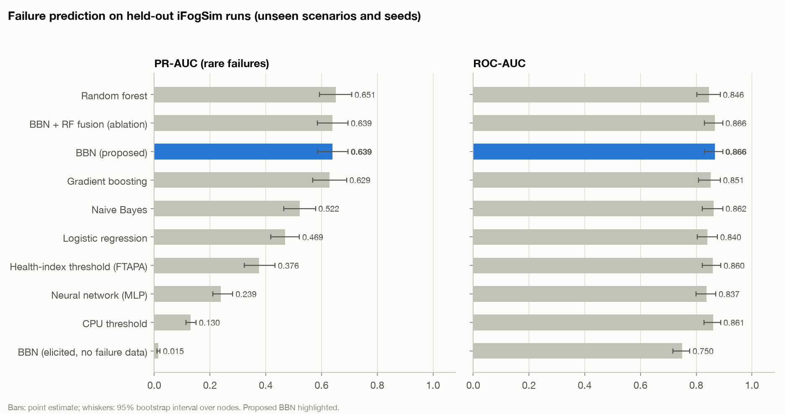
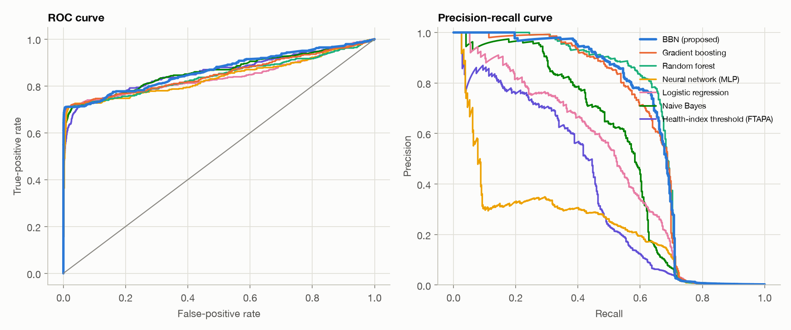
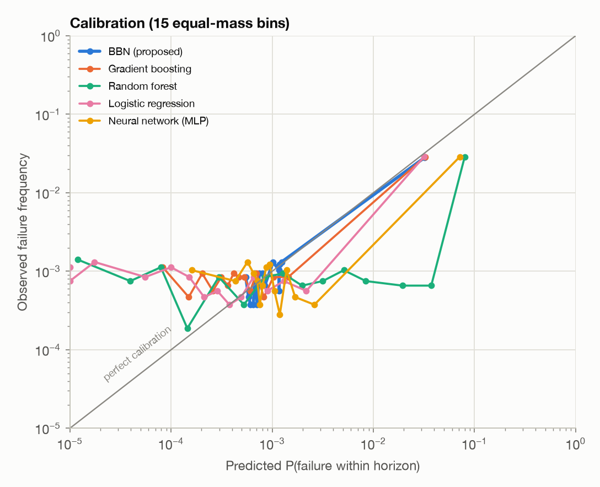
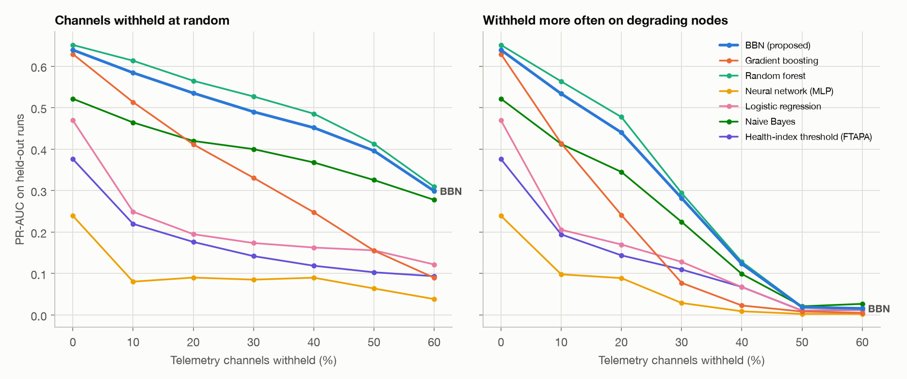
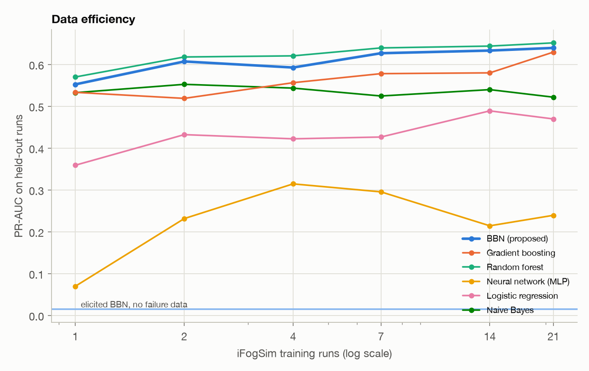

# Failure-prediction model comparison

Held-out evaluation on **159,813 fog and edge snapshots** (422 positive, natural prevalence 0.26%) from iFogSim runs whose scenarios *and* seeds were never seen in training. Training: 314,323 snapshots (1508 positive). Every choice a model makes (class weighting, fusion weight, alarm threshold) was made on out-of-fold predictions over four scenario folds of the training runs.

## Headline metrics

| Model | Family | ROC-AUC [95% CI] | PR-AUC [95% CI] | Brier | ECE | F1 | Precision | Recall | Flagged in time | µs / prediction |
|---|---|---:|---:|---:|---:|---:|---:|---:|---:|---:|
| Random forest | machine learning | 0.846 [0.802, 0.886] | 0.651 [0.592, 0.708] | 0.00157 | 0.00844 | 0.687 | 0.861 | 0.571 | 0.68 | 2.0 |
| **BBN (proposed)** | Bayesian network | 0.866 [0.829, 0.895] | 0.639 [0.585, 0.695] | 0.00128 | 0.00048 | 0.658 | 0.825 | 0.547 | 0.63 | 3.6 |
| BBN + RF fusion (ablation) | hybrid | 0.866 [0.829, 0.895] | 0.639 [0.585, 0.695] | 0.00128 | 0.00048 | 0.658 | 0.825 | 0.547 | 0.63 | 5.6 |
| Gradient boosting | machine learning | 0.851 [0.809, 0.886] | 0.629 [0.569, 0.690] | 0.00134 | 0.00064 | 0.645 | 0.852 | 0.519 | 0.63 | 1.7 |
| Naive Bayes | Bayesian network | 0.862 [0.822, 0.895] | 0.522 [0.465, 0.578] | 0.01510 | 0.01689 | 0.549 | 0.527 | 0.573 | 0.62 | 3.7 |
| Logistic regression | machine learning | 0.840 [0.803, 0.876] | 0.469 [0.419, 0.521] | 0.00180 | 0.00078 | 0.491 | 0.452 | 0.538 | 0.59 | 0.1 |
| Health-index threshold (FTAPA) | threshold rule | 0.860 [0.822, 0.888] | 0.376 [0.324, 0.433] | n/a | n/a | 0.466 | 0.529 | 0.417 | 0.47 | 0.0 |
| Neural network (MLP) | machine learning | 0.837 [0.799, 0.870] | 0.239 [0.210, 0.282] | 0.00328 | 0.00342 | 0.332 | 0.246 | 0.509 | 0.57 | 0.2 |
| CPU threshold | threshold rule | 0.861 [0.827, 0.888] | 0.130 [0.114, 0.150] | n/a | n/a | 0.295 | 0.217 | 0.462 | 0.53 | 0.0 |
| BBN (elicited, no failure data) | Bayesian network | 0.750 [0.717, 0.777] | 0.015 [0.010, 0.021] | 0.09975 | 0.29375 | 0.082 | 0.077 | 0.088 | 0.10 | 0.5 |

Threshold rules produce a ranking score, not a probability, so Brier and ECE are not reported for them. ECE uses 15 equal-mass bins.

## How much accuracy is achievable

122 of the 422 held-out failures (29%) are *sudden*: by construction they have no precursor, so no model can foresee them. That caps every model's score on this pool.

| Predictor | ROC-AUC | PR-AUC | ROC-AUC on fog nodes |
|---|---:|---:|---:|
| Ceiling: clairvoyant about every wear-out and battery failure, per-class rate for sudden ones | 0.872 | 0.712 | 0.897 |
| Oracle that knows each node's hidden health | 0.848 | 0.636 | 0.896 |
| **BBN (proposed)** | 0.866 | 0.639 | 0.898 |
| best other model on fog nodes (CPU threshold) | | | 0.892 |

The BBN reaches 99% of the achievable ROC-AUC and 90% of the achievable PR-AUC. On fog nodes, where a failure is either wear (which hidden health tracks) or sudden, it ranks failures as well as the oracle that knows the hidden health. This is also the leak check: a model clearly above that oracle on fog nodes would be using information it cannot have. (On edge devices the observed residual energy foresees battery failures, which hidden health does not, so the oracle is not a bound there.)

## Calibration

The controller multiplies the posterior by a cost (`P(fail) x C_fail > C_mig`), so a stated probability must mean what it says.

## Robustness to missing telemetry

Models are trained on complete telemetry and then scored while channels are withheld: at random (MCAR), and -- harder and more realistic -- more often on degrading nodes (MNAR, probability scaled by 1 + damage, so a failing node loses up to twice as many readings). The BBN sums a missing channel out of Eq. (1); the classical models impute it with the training median plus a missing indicator.

| Model | MCAR 0% | MCAR 10% | MCAR 20% | MCAR 30% | MCAR 40% | MCAR 50% | MCAR 60% | MNAR 10% | MNAR 20% | MNAR 30% | MNAR 40% | MNAR 50% | MNAR 60% |
|---|---:|---:|---:|---:|---:|---:|---:|---:|---:|---:|---:|---:|---:|
| Random forest | 0.651 | 0.613 | 0.565 | 0.527 | 0.486 | 0.413 | 0.309 | 0.563 | 0.478 | 0.294 | 0.128 | 0.020 | 0.016 |
| BBN (proposed) | 0.639 | 0.584 | 0.535 | 0.490 | 0.452 | 0.396 | 0.299 | 0.534 | 0.440 | 0.282 | 0.123 | 0.019 | 0.016 |
| BBN + RF fusion (ablation) | 0.639 | 0.584 | 0.535 | 0.490 | 0.452 | 0.396 | 0.299 | 0.534 | 0.440 | 0.282 | 0.123 | 0.019 | 0.016 |
| Gradient boosting | 0.629 | 0.513 | 0.412 | 0.331 | 0.248 | 0.155 | 0.090 | 0.414 | 0.241 | 0.078 | 0.023 | 0.008 | 0.005 |
| Naive Bayes | 0.522 | 0.464 | 0.420 | 0.400 | 0.368 | 0.326 | 0.278 | 0.413 | 0.345 | 0.225 | 0.099 | 0.021 | 0.027 |
| Logistic regression | 0.469 | 0.249 | 0.195 | 0.174 | 0.163 | 0.156 | 0.122 | 0.206 | 0.170 | 0.128 | 0.067 | 0.011 | 0.013 |
| Health-index threshold (FTAPA) | 0.376 | 0.220 | 0.176 | 0.142 | 0.119 | 0.103 | 0.094 | 0.194 | 0.144 | 0.110 | 0.068 | 0.011 | 0.012 |
| Neural network (MLP) | 0.239 | 0.081 | 0.090 | 0.085 | 0.090 | 0.064 | 0.038 | 0.098 | 0.089 | 0.029 | 0.009 | 0.003 | 0.003 |
| CPU threshold | 0.130 | 0.123 | 0.110 | 0.099 | 0.087 | 0.073 | 0.058 | 0.105 | 0.079 | 0.049 | 0.020 | 0.004 | 0.005 |
| BBN (elicited, no failure data) | 0.015 | 0.008 | 0.006 | 0.006 | 0.006 | 0.005 | 0.005 | 0.006 | 0.005 | 0.004 | 0.003 | 0.003 | 0.003 |

Values are PR-AUC on the held-out pool.

ROC-AUC under the same conditions:

| Model | MCAR 0% | MCAR 10% | MCAR 20% | MCAR 30% | MCAR 40% | MCAR 50% | MCAR 60% | MNAR 10% | MNAR 20% | MNAR 30% | MNAR 40% | MNAR 50% | MNAR 60% |
|---|---:|---:|---:|---:|---:|---:|---:|---:|---:|---:|---:|---:|---:|
| Random forest | 0.846 | 0.849 | 0.847 | 0.845 | 0.842 | 0.831 | 0.813 | 0.842 | 0.837 | 0.798 | 0.674 | 0.392 | 0.424 |
| BBN (proposed) | 0.866 | 0.864 | 0.860 | 0.864 | 0.853 | 0.839 | 0.812 | 0.861 | 0.857 | 0.824 | 0.738 | 0.623 | 0.614 |
| BBN + RF fusion (ablation) | 0.866 | 0.864 | 0.860 | 0.864 | 0.853 | 0.839 | 0.812 | 0.861 | 0.857 | 0.824 | 0.738 | 0.623 | 0.614 |
| Gradient boosting | 0.851 | 0.843 | 0.831 | 0.808 | 0.784 | 0.751 | 0.712 | 0.825 | 0.779 | 0.711 | 0.649 | 0.607 | 0.598 |
| Naive Bayes | 0.862 | 0.856 | 0.855 | 0.855 | 0.854 | 0.851 | 0.850 | 0.855 | 0.853 | 0.851 | 0.842 | 0.810 | 0.782 |
| Logistic regression | 0.840 | 0.785 | 0.726 | 0.695 | 0.670 | 0.652 | 0.613 | 0.728 | 0.676 | 0.629 | 0.598 | 0.591 | 0.591 |
| Health-index threshold (FTAPA) | 0.860 | 0.856 | 0.852 | 0.840 | 0.828 | 0.807 | 0.763 | 0.852 | 0.828 | 0.763 | 0.617 | 0.407 | 0.447 |
| Neural network (MLP) | 0.837 | 0.775 | 0.751 | 0.718 | 0.701 | 0.696 | 0.668 | 0.753 | 0.698 | 0.645 | 0.533 | 0.438 | 0.482 |
| CPU threshold | 0.861 | 0.820 | 0.778 | 0.734 | 0.695 | 0.655 | 0.612 | 0.776 | 0.690 | 0.604 | 0.525 | 0.466 | 0.479 |
| BBN (elicited, no failure data) | 0.750 | 0.734 | 0.720 | 0.714 | 0.704 | 0.689 | 0.672 | 0.716 | 0.697 | 0.660 | 0.614 | 0.560 | 0.555 |

Log-loss (lower is better) under the same conditions:

| Model | MCAR 0% | MCAR 10% | MCAR 20% | MCAR 30% | MCAR 40% | MCAR 50% | MCAR 60% | MNAR 10% | MNAR 20% | MNAR 30% | MNAR 40% | MNAR 50% | MNAR 60% |
|---|---:|---:|---:|---:|---:|---:|---:|---:|---:|---:|---:|---:|---:|
| Random forest | 0.0159 | 0.0157 | 0.0157 | 0.0155 | 0.0153 | 0.0154 | 0.0157 | 0.0162 | 0.0164 | 0.0174 | 0.0198 | 0.0252 | 0.0243 |
| BBN (proposed) | 0.0082 | 0.0089 | 0.0098 | 0.0106 | 0.0116 | 0.0128 | 0.0143 | 0.0098 | 0.0116 | 0.0141 | 0.0167 | 0.0187 | 0.0189 |
| BBN + RF fusion (ablation) | 0.0082 | 0.0089 | 0.0098 | 0.0106 | 0.0116 | 0.0128 | 0.0143 | 0.0098 | 0.0116 | 0.0141 | 0.0167 | 0.0187 | 0.0189 |
| Gradient boosting | 0.0085 | 0.0103 | 0.0119 | 0.0133 | 0.0147 | 0.0162 | 0.0174 | 0.0119 | 0.0149 | 0.0175 | 0.0188 | 0.0196 | 0.0197 |
| Naive Bayes | 0.1205 | 0.1077 | 0.0935 | 0.0796 | 0.0664 | 0.0527 | 0.0398 | 0.0999 | 0.0766 | 0.0546 | 0.0365 | 0.0272 | 0.0213 |
| Logistic regression | 0.0113 | 0.0145 | 0.0174 | 0.0192 | 0.0206 | 0.0213 | 0.0224 | 0.0169 | 0.0203 | 0.0227 | 0.0240 | 0.0237 | 0.0222 |
| Neural network (MLP) | 0.0163 | 0.1063 | 0.1651 | 0.1945 | 0.1978 | 0.1789 | 0.1447 | 0.1283 | 0.1819 | 0.1895 | 0.1678 | 0.1256 | 0.0815 |
| BBN (elicited, no failure data) | 0.3652 | 0.3665 | 0.3680 | 0.3693 | 0.3707 | 0.3721 | 0.3735 | 0.3657 | 0.3664 | 0.3670 | 0.3674 | 0.3681 | 0.3688 |

Under heavy degradation-correlated loss (30-60%) a failing node loses most of its readings, and every model that treats a missing value as uninformative drifts toward the prior. Best ranking there (mean ROC-AUC): Naive Bayes; best probabilities (mean log-loss): BBN (proposed).

## Data efficiency

PR-AUC on the held-out pool when each model is trained on a random subset of the 21 training runs (mean of three subsets). The elicited BBN uses no failure data at all.

| Model | 0 runs | 1 runs | 2 runs | 4 runs | 7 runs | 14 runs | 21 runs |
|---|---:|---:|---:|---:|---:|---:|---:|
| BBN (elicited, no failure data) | 0.015 |  |  |  |  |  |  |
| BBN (proposed) |  | 0.552 | 0.607 | 0.592 | 0.627 | 0.633 | 0.639 |
| Gradient boosting |  | 0.533 | 0.519 | 0.556 | 0.578 | 0.580 | 0.629 |
| Logistic regression |  | 0.359 | 0.432 | 0.422 | 0.426 | 0.489 | 0.469 |
| Naive Bayes |  | 0.532 | 0.552 | 0.543 | 0.524 | 0.540 | 0.522 |
| Neural network (MLP) |  | 0.070 | 0.231 | 0.314 | 0.295 | 0.214 | 0.239 |
| Random forest |  | 0.570 | 0.618 | 0.620 | 0.639 | 0.644 | 0.651 |

## Why the BBN -- scorecard

| Criterion | Best model | Best | BBN | BBN status |
|---|---|---:|---:|---|
| PR-AUC (held-out) | Random forest | 0.651 | 0.639 | tie (overlapping 95% CI) |
| ROC-AUC (held-out) | BBN (proposed) | 0.866 | 0.866 | best |
| F1 at training-fold threshold | Random forest | 0.687 | 0.658 | behind |
| Brier score (lower is better) | BBN (proposed) | 0.00128 | 0.00128 | best |
| Calibration error, ECE (lower) | BBN (proposed) | 0.00048 | 0.00048 | best |
| Failing nodes flagged in time | Random forest | 0.678 | 0.630 | behind |
| PR-AUC with 30-60% random telemetry loss | Random forest | 0.434 | 0.409 | behind |
| PR-AUC with 30-60% degradation-correlated telemetry loss | Random forest | 0.115 | 0.110 | behind |
| ROC-AUC with 30-60% random telemetry loss | Naive Bayes | 0.853 | 0.842 | behind |
| ROC-AUC with 30-60% degradation-correlated telemetry loss | Naive Bayes | 0.821 | 0.700 | behind |
| Log-loss (lower) with 30-60% random telemetry loss | BBN (proposed) | 0.0124 | 0.0124 | best |
| Log-loss (lower) with 30-60% degradation-correlated telemetry loss | BBN (proposed) | 0.0171 | 0.0171 | best |
| PR-AUC trained on only 1-2 runs | Random forest | 0.594 | 0.580 | behind |
| Usable with no failure data at all | BBN (elicited) | 0.015 | 0.015 | best -- only a Bayesian network with elicited priors produces a probability before any failure has been observed (value: PR-AUC) |
| Explains each prediction (names the cause) | BBN (proposed) |  |  | best -- latent-condition lift; no other model in the comparison does |

The proposed BBN is best on 7 of 15 criteria and statistically tied on 1 more. Criteria where it is behind are listed as such above.

## Notes

- The BBN configuration ({'family': 'ranked', 'trends': True, 'class_conditional': True, 'class_latent': True, 'cuts': 'supervised', 'states': 8, 'per_class_cuts': True, 'concentration': 1.0, 'iterations': 60, 'lam': 0.02}) was chosen by `select_bbn.py` on the training scenarios only.
- The hybrid BBN + random-forest fusion (weight 1.0 on the BBN, chosen out-of-fold) is reported as an ablation, not as the proposed model.
- Gradient boosting was the best classical model out-of-fold; it is exported to `data/models/ml_best.json` and drives the ML policy in the closed-loop experiment.
- Failure labels come from the project's degradation fault model (iFogSim has no native failure model); results are a simulation study, not field validation.
