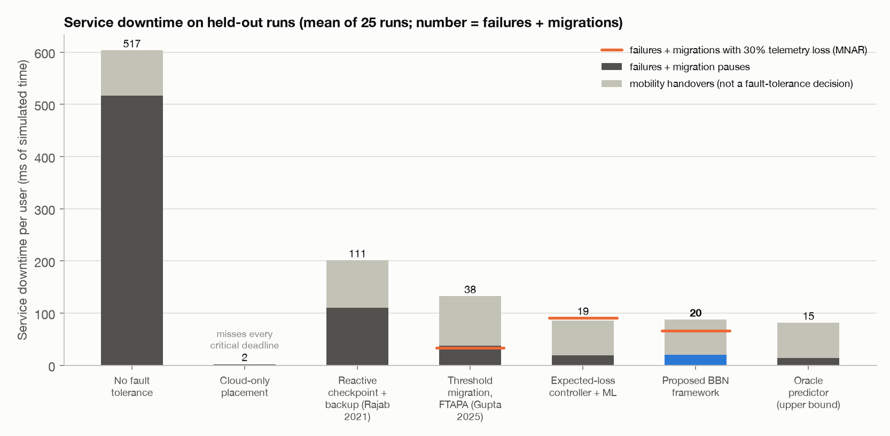
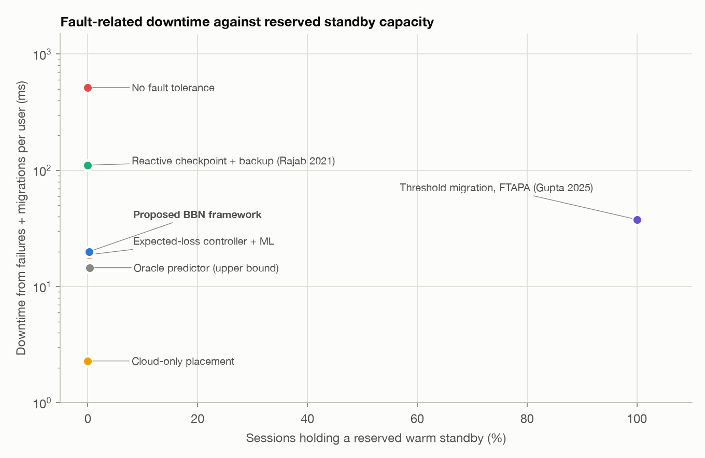
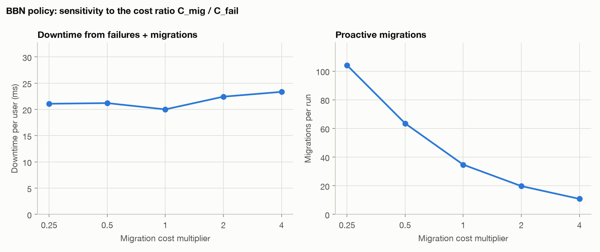
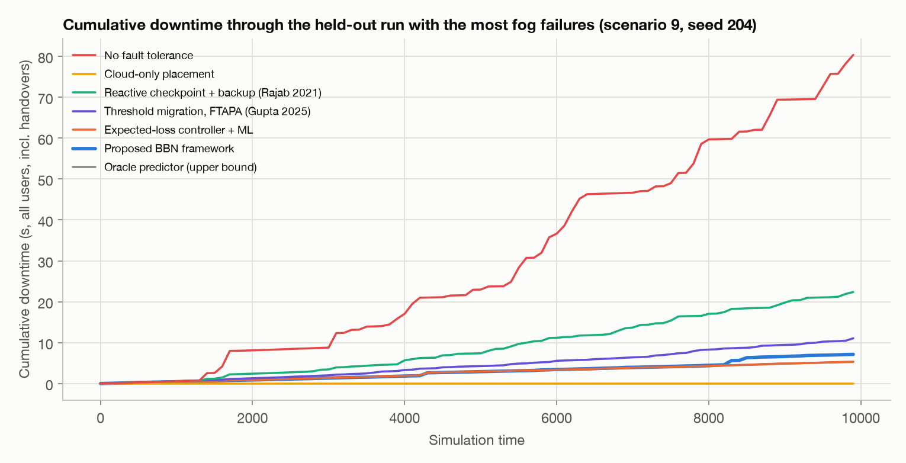

# Closed-loop fault tolerance in iFogSim

Each policy ran on the same 25 held-out runs (5 unseen scenarios x 5 unseen seeds, 10000 time units each) with identical exogenous randomness. Values are mean ± standard deviation over runs.

Downtime has three sources: node failures (detection plus recovery), the pauses of proactive migrations, and mobility handovers (a user walking to another gateway is re-associated, whatever the policy). Fault tolerance acts on the first two, reported as *failures + migrations*; handover downtime is about the same for every policy that serves users from the fog.

| Policy | Downtime / user (ms) | Failures + migrations / user (ms) | Availability (%) | Critical availability (%) | Alarms delivered (%) | Fog failures | Users hit | Users evacuated | Migrations (from degraded nodes) | Warm standby (%) | Loop p95 (ms) | Critical deadline misses (%) |
|---|---:|---:|---:|---:|---:|---:|---:|---:|---:|---:|---:|---:|
| No fault tolerance | 603.4 ± 387.8 | 517.2 ± 391.7 | 93.816 ± 3.990 | 93.992 ± 3.836 | 89.02 ± 11.02 | 18.4 ± 12.1 | 78.5 ± 66.4 | 0.0 ± 0.0 | 0.0 (0.0) | 0.0 | 115.9 | 3.82 |
| Cloud-only placement | 2.3 ± 3.2 | 2.3 ± 3.2 | 99.976 ± 0.033 | 99.981 ± 0.039 | 96.91 ± 1.44 | 4.0 ± 1.8 | 2.0 ± 2.9 | 0.0 ± 0.0 | 0.0 (0.0) | 0.0 | 310.1 | 100.00 |
| Reactive checkpoint + backup (Rajab 2021) | 201.2 ± 93.7 | 110.9 ± 94.7 | 97.938 ± 0.964 | 97.321 ± 1.165 | 91.81 ± 10.44 | 19.9 ± 13.8 | 89.2 ± 84.3 | 0.0 ± 0.0 | 0.0 (0.0) | 0.0 | 121.8 | 4.39 |
| Threshold migration, FTAPA (Gupta 2025) | 132.4 ± 33.4 | 37.7 ± 29.8 | 98.643 ± 0.343 | 98.064 ± 0.410 | 94.90 ± 6.94 | 19.4 ± 13.4 | 54.1 ± 49.1 | 33.0 ± 37.8 | 105.9 (102.3) | 100.0 | 148.2 | 5.46 |
| Expected-loss controller + ML | 86.2 ± 16.6 | 18.8 ± 16.8 | 99.115 ± 0.175 | 98.733 ± 0.325 | 99.37 ± 0.37 | 10.4 ± 9.9 | 3.8 ± 3.5 | 6.4 ± 10.8 | 28.4 (28.2) | 0.3 | 35.1 | 0.22 |
| **Proposed BBN framework** | 87.6 ± 15.2 | 20.0 ± 14.7 | 99.101 ± 0.165 | 98.754 ± 0.291 | 99.37 ± 0.35 | 10.0 ± 9.6 | 4.5 ± 4.9 | 4.3 ± 7.7 | 34.7 (30.0) | 0.2 | 35.1 | 0.13 |
| Oracle predictor (upper bound) | 81.5 ± 13.9 | 14.5 ± 14.3 | 99.163 ± 0.152 | 98.803 ± 0.211 | 99.37 ± 0.43 | 11.2 ± 10.5 | 3.4 ± 4.1 | 10.0 ± 14.4 | 24.8 (24.8) | 0.4 | 36.3 | 0.12 |

*Users hit*: sessions on a node when it failed. *Users evacuated*: sessions moved off a node within the horizon before it failed. *From degraded nodes*: migrations whose source node was genuinely worn (hidden health < 0.42, i.e. at least 1.5x work inflation) when the decision was made -- a migration that unloads such a node can prevent its failure, so 'the node did not fail afterwards' is not evidence of a false alarm. The *oracle* runs the same controller as the BBN and ML policies with the best possible predictor: it knows each node's hidden health and the wear law (not future random draws, so sudden failures still surprise it), which bounds what any predictor could achieve. *Cloud-only* avoids fog state loss but every alarm crosses the WAN: it misses the 150 ms critical deadline on every loop.

Users hit, by how their node failed (sudden failures have no precursor by construction):

| Policy | Users hit by wear-out or shock failures | Users hit by sudden failures |
|---|---:|---:|
| No fault tolerance | 77.4 | 1.1 |
| Cloud-only placement | 0.6 | 1.3 |
| Reactive checkpoint + backup (Rajab 2021) | 87.9 | 1.4 |
| Threshold migration, FTAPA (Gupta 2025) | 52.9 | 1.2 |
| Expected-loss controller + ML | 2.4 | 1.4 |
| **Proposed BBN framework** | 3.0 | 1.4 |
| Oracle predictor (upper bound) | 2.2 | 1.2 |

## Paired comparisons (BBN against each policy)

Wilcoxon signed-rank test over the paired held-out runs; negative change means the BBN framework has less downtime.

| Against | Downtime change (%) | p-value | Failures + migrations change (%) | p-value | Critical downtime change (%) | p-value |
|---|---:|---:|---:|---:|---:|---:|
| No fault tolerance | -87.3 | <0.0001 | -96.8 | <0.0001 | -82.3 | <0.0001 |
| Cloud-only placement | +4218.0 | <0.0001 | +862.6 | <0.0001 | +7390.5 | <0.0001 |
| Reactive checkpoint + backup (Rajab 2021) | -60.1 | <0.0001 | -85.0 | <0.0001 | -58.1 | <0.0001 |
| Threshold migration, FTAPA (Gupta 2025) | -36.9 | <0.0001 | -55.4 | 0.0016 | -39.3 | <0.0001 |
| Expected-loss controller + ML | +3.7 | 0.0903 | +18.5 | 0.1219 | -1.3 | 0.9368 |
| Oracle predictor (upper bound) | +9.8 | 0.0004 | +58.3 | 0.0009 | +3.1 | 0.0883 |

## With degraded telemetry (30% of channels missing, MNAR)

Channels go missing more often on degrading nodes (rate x (1 + damage)), the case Review 1 raises: a channel falls silent exactly when its node is in trouble.

| Policy | Downtime / user (ms) | Failures + migrations / user (ms) | Change vs complete telemetry (%) | Users hit | Users evacuated |
|---|---:|---:|---:|---:|---:|
| Threshold migration, FTAPA (Gupta 2025) | 133.7 ± 33.2 | 33.9 ± 25.4 | -10.2 | 41.4 ± 36.3 | 29.9 ± 35.9 |
| Expected-loss controller + ML | 156.2 ± 99.3 | 90.6 ± 98.7 | +381.5 | 15.6 ± 19.0 | 3.2 ± 3.7 |
| **Proposed BBN framework** | 131.8 ± 65.4 | 65.9 ± 64.5 | +229.4 | 13.4 ± 15.3 | 6.6 ± 9.1 |

| BBN against, with degraded telemetry | Failures + migrations change (%) | p-value | Downtime change (%) | p-value |
|---|---:|---:|---:|---:|
| Threshold migration, FTAPA (Gupta 2025) | +90.4 | 0.0042 | +0.7 | 0.5602 |
| Expected-loss controller + ML | -29.2 | 0.0064 | -17.9 | 0.0236 |

## Sensitivity of the BBN policy to the cost ratio

Every migration cost multiplied by the factor shown (the derived threshold P* = C_mig / C_fail scales with it).

| Cost multiplier | Failures + migrations / user (ms) | Migrations (from degraded nodes) | Users hit | Users evacuated | Warm standby (%) |
|---:|---:|---:|---:|---:|---:|
| 0.25 | 21.1 ± 14.5 | 104.1 (59.9) | 3.6 | 2.7 | 0.1 |
| 0.5 | 21.2 ± 14.8 | 63.5 (43.4) | 3.9 | 4.4 | 0.2 |
| 1 | 20.0 ± 14.7 | 34.7 (30.0) | 4.5 | 4.3 | 0.2 |
| 2 | 22.4 ± 18.3 | 19.8 (18.4) | 5.2 | 4.2 | 0.3 |
| 4 | 23.3 ± 19.9 | 10.8 (10.6) | 6.0 | 2.7 | 0.2 |

## Ablation: what each component contributes

The BBN policy on the same runs with one component removed. The p-value is a paired Wilcoxon test on failures + migrations downtime.

| Variant | Failures + migrations / user (ms) | Change vs full (%) | p-value | Fog failures | Users hit | Users evacuated | Migrations | Warm standby (%) |
|---|---:|---:|---:|---:|---:|---:|---:|---:|
| full framework | 20.0 ± 14.7 | -- | | 10.0 | 4.5 | 4.3 | 34.7 | 0.2 |
| without online CPT learning | 22.2 ± 17.3 | +10.9 | 0.6274 | 9.8 | 4.3 | 4.4 | 34.2 | 0.2 |
| without the risk term in placement (N2) | 34.2 ± 29.1 | +71.0 | 0.0036 | 11.0 | 8.1 | 21.3 | 58.2 | 0.5 |
| without proactive migration (N2) | 18.6 ± 15.1 | -7.2 | 0.1169 | 10.2 | 5.0 | 0.0 | 0.0 | 0.2 |
| without selective replication (N3) | 31.6 ± 26.5 | +57.7 | 0.0196 | 9.6 | 3.6 | 5.1 | 44.5 | 0.0 |
