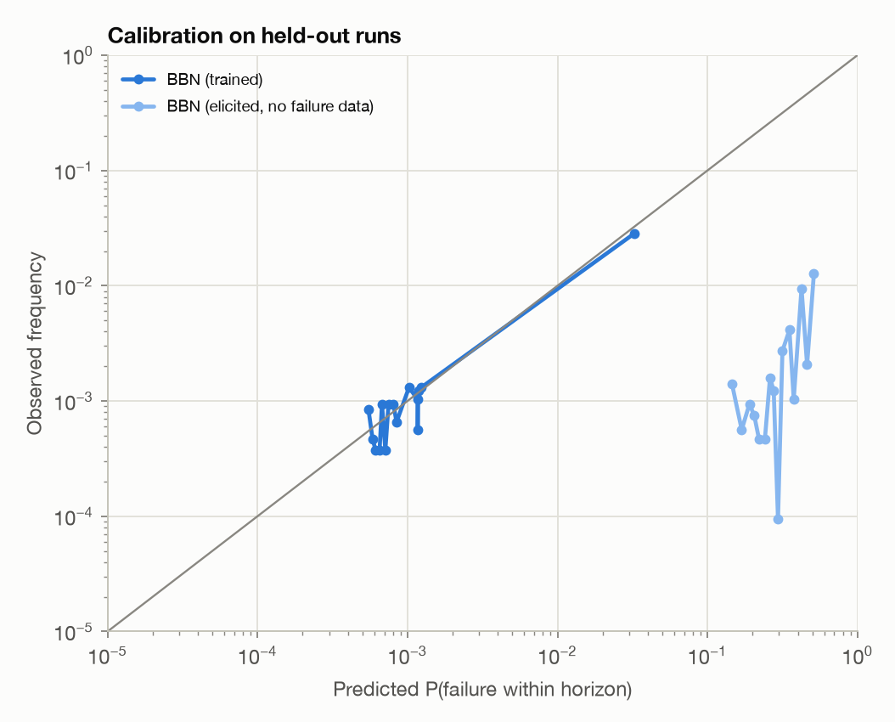
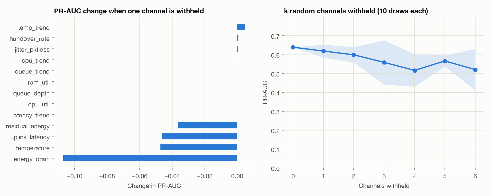

# BBN failure prediction -- verification report

- Held-out pool: **159,813 fog and edge snapshots, 422 positive** (0.26%) from runs whose scenarios and seeds were never used in training.
- Network: `fig2+trends+class-evidence+class-latent+ranked` with `supervised-per-class` cut points; trained by MAP-EM on 314,323 snapshots (1508 positive, 43,374 distinct patterns), Dirichlet concentration 1.0, 60 iterations.
- Look-ahead horizon: 200 time units (two decision epochs).

## 1. Discrimination

| Network | ROC-AUC | 95% CI | PR-AUC | 95% CI |
|---|---:|---|---:|---|
| trained (proposed) | 0.8665 | [0.8290, 0.8948] | 0.6393 | [0.5845, 0.6950] |
| elicited only, paper Fig. 2, no failure data | 0.7496 | [0.7168, 0.7767] | 0.0146 | [0.0102, 0.0211] |

Chance level for PR-AUC is the prevalence, 0.0026. Intervals resample whole nodes.

## 2. Alarms across thresholds

| Threshold | TP | FP | FN | Precision | Recall | F1 |
|---:|---:|---:|---:|---:|---:|---:|
| 0.02 | 297 | 761 | 125 | 0.281 | 0.704 | 0.401 |
| 0.05 | 292 | 397 | 130 | 0.424 | 0.692 | 0.526 |
| 0.10 | 286 | 247 | 136 | 0.537 | 0.678 | 0.599 |
| 0.20 | 276 | 139 | 146 | 0.665 | 0.654 | 0.659 |
| 0.30 | 268 | 87 | 154 | 0.755 | 0.635 | 0.690 |
| 0.50 | 231 | 49 | 191 | 0.825 | 0.547 | 0.658 |

At the operating threshold chosen on training folds (0.4994): precision 0.825, recall 0.547, F1 0.658. The fault-tolerance controller does not use a fixed threshold at all: it migrates when P(fail) x C_fail > C_mig, so each session gets its own.

## 3. Calibration

Brier score 0.00128, log-loss 0.00815, ECE 0.00048 (15 equal-mass bins). Mean predicted probability 0.0030 against an observed failure rate of 0.0026.

## 4. Early warning

Of 211 failing nodes, **133 (63%)** were flagged inside the two epochs before they failed, with a mean lead of 127 time units; 0.3 alarms per 1,000 healthy snapshots. A live migration needs 5-30 time units, so a flag raised within the horizon leaves time to act. Nodes are grouped by scenario, seed and node.

## 5. Does the named cause match how the node failed?

Rows: how positive (failing-within-horizon) snapshots actually failed. Columns: the latent condition the BBN named as the principal cause (largest lift of P(high) over its prior; *none* when no condition rose). Share of the row, with the count in brackets.

| Actual cause | Snapshots | computational_stress | energy_stress | network_degradation | none | thermal_stress |
|---|---:|---:|---:|---:|---:|---:|
| battery | 22 | 0.00 (0) | 0.86 (19) | 0.14 (3) | 0.00 (0) | 0.00 (0) |
| sudden | 122 | 0.02 (2) | 0.16 (20) | 0.30 (37) | 0.52 (63) | 0.00 (0) |
| wear-out | 278 | 0.04 (11) | 0.92 (255) | 0.04 (11) | 0.00 (0) | 0.00 (1) |

Battery failures should be blamed on energy stress. Sudden failures have no precursor by construction, so the network should mostly raise nothing for them. For wear-out, energy stress is the expected answer in this simulator: a fog node's wear rate rises with its energy depletion as well as its load and heat, and a worn node draws extra power, so the drain rate is the earliest symptom of wear (it is also the channel whose loss costs the most PR-AUC in section 6); computational and thermal symptoms grow later, with the square and the 1.5th power of the damage.

## 6. Partial evidence

| Channel withheld | PR-AUC | ROC-AUC | Change in PR-AUC |
|---|---:|---:|---:|
| energy_drain | 0.5323 | 0.8657 | -0.1070 |
| temperature | 0.5921 | 0.8659 | -0.0472 |
| uplink_latency | 0.5930 | 0.8706 | -0.0463 |
| residual_energy | 0.6029 | 0.8649 | -0.0364 |
| latency_trend | 0.6391 | 0.8669 | -0.0002 |
| cpu_util | 0.6391 | 0.8667 | -0.0002 |
| queue_depth | 0.6393 | 0.8667 | -0.0000 |
| ram_util | 0.6393 | 0.8676 | -0.0000 |
| queue_trend | 0.6393 | 0.8669 | -0.0000 |
| cpu_trend | 0.6393 | 0.8670 | +0.0000 |
| jitter_pktloss | 0.6398 | 0.8684 | +0.0005 |
| handover_rate | 0.6400 | 0.8665 | +0.0007 |
| temp_trend | 0.6442 | 0.8663 | +0.0049 |

| Channels withheld (random) | PR-AUC | s.d. | ROC-AUC | Predictions made |
|---:|---:|---:|---:|---:|
| 0 | 0.6393 | 0.0000 | 0.8665 | 159,813 |
| 1 | 0.6192 | 0.0343 | 0.8671 | 159,813 |
| 2 | 0.5991 | 0.0409 | 0.8683 | 159,813 |
| 3 | 0.5592 | 0.1169 | 0.8662 | 159,813 |
| 4 | 0.5168 | 0.0858 | 0.8649 | 159,813 |
| 5 | 0.5667 | 0.0297 | 0.8654 | 159,813 |
| 6 | 0.5210 | 0.1094 | 0.8629 | 159,813 |

A prediction is produced for every snapshot however many channels are dark: missing evidence is summed out of Eq. (1), never imputed.

